# AfricanFalls Disk Forensics — Investigating Reconnaissance, Anti-Forensics, Credentials & Mobile Artifacts on Windows 10

**Incident Type:** Insider / Suspect Workstation Triage, Reconnaissance & Anti-Forensics Investigation (AfricanFalls)
**Date:** November 28, 2026
**Status:** Completed
**Environment:** CyberDefenders – *AfricanFalls Lab* (simulated SOC/IR exercise)

## Executive Summary

A logical forensic image (`DiskDrigger.ad1`) from a suspect Windows workstation (user `John Doe`) was submitted for full-disk triage. Using **FTK Imager**, **Autopsy**, **DBeaver/SQLite**, **BrowsingHistoryView**, **PECmd**, **ShellBags Explorer**, **regipy**, **Impacket `secretsdump.py`**, **Hashcat**, and Linux command-line inspection (`grep`), I verified evidence integrity, reconstructed browser and download activity, uncovered deleted wordlists and anonymization tooling, traced FTP and network slack artifacts, reviewed PowerShell reconnaissance/anti-forensics commands, correlated mobile camera EXIF geolocation with MTP ShellBags, and recovered local registry credentials.

Analysis verified `DiskDrigger.ad1` integrity (`MD5: 9471e69c95d8909ae60ddff30d50ffa1`, `SHA1: 167aa08db25dfeeb876b0176ddc329a3d9f2803a`). Triage revealed that on `2021-04-29` `John Doe` searched Google for `password cracking lists` (`18:17:38 UTC`), visited `danielmiessler/SecLists` on GitHub, downloaded and subsequently deleted `10-million-password-list-top-100.txt` (`18:22:17`), executed the Tor Browser installer (`TORBROWSER-INSTALL-WIN64-10.0`, `18:22:32`), and accessed ProtonMail as `dreammaker82@protonmail.com` on `2021-04-30`. Further artifacts exposed a `10.0.2.15` QUIC address and `portswigger.net` residue in FileZilla file slack, an FTP connection to `192.168.1.20:21` as user `kali`, PowerShell history containing `nmap dfir.science`, `ipconfig /flushdns`, and `sdelete .\accountNum`, geotagged photos (`-16.000000, 23.000000`) taken on an `LG Electronics LM-Q725K` correlated with MTP ShellBags (`LG Q7\Internal storage\DCIM\Camera`), and local SAM/NTLM credential hashes extracted after replaying `SYSTEM` registry transaction logs.

## Investigation Workflow

1. **Evidence Integrity Verification** – validate MD5 and SHA1 hashes of `DiskDrigger.ad1` in FTK Imager before analysis.
2. **Browser & Online Account Triage** – query Chrome SQLite `urls` history and review `BrowsingHistoryView` for offensive wordlist research and webmail accounts.
3. **Deleted Files & Execution Artifacts** – inspect Recycle Bin `$I`/`$R` pairs and Windows Prefetch (`PECmd`) for downloaded wordlists and privacy/anonymization installers.
4. **Network & File Transfer Forensics** – carve IP addresses from FileZilla file slack (`grep`) and inspect `recentservers.xml` for remote hosts and credentials.
5. **Command-Line & Anti-Forensics Review** – analyze PowerShell `ConsoleHost_history.txt` for reconnaissance (`nmap`) and secure-deletion (`sdelete`) commands.
6. **Mobile Device & Geolocation Correlation** – extract smartphone photos in Autopsy, parse EXIF GPS/camera metadata, and corroborate device attachment via ShellBags.
7. **Registry Repair & Credential Analysis** – replay `SYSTEM` transaction logs (`regipy`), dump local SAM hashes (`secretsdump.py`), and crack NTLM hashes (`hashcat`).

---

## 1. Evidence Integrity Verification — `DiskDrigger.ad1`

Prior to forensic examination, verifying the acquired logical image (`DiskDrigger.ad1`) in **FTK Imager** confirmed zero alteration between acquisition and analysis:

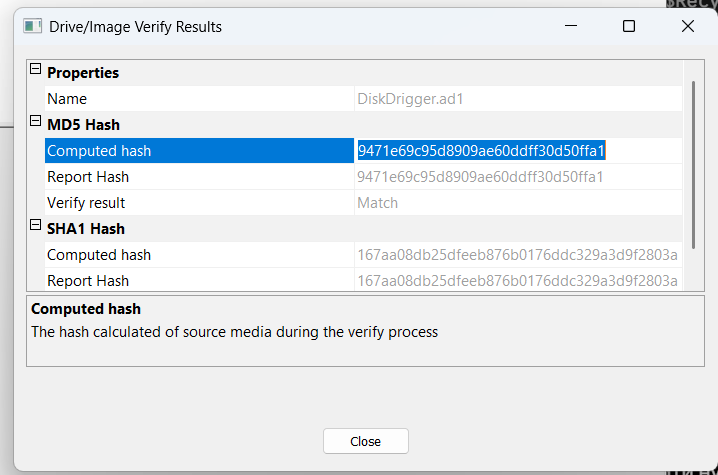
*Figure 1 – `Drive/Image Verify Results` for `DiskDrigger.ad1`:*
- **MD5 Hash (Computed & Report):** `9471e69c95d8909ae60ddff30d50ffa1` (`Match`).
- **SHA1 Hash (Computed & Report):** `167aa08db25dfeeb876b0176ddc329a3d9f2803a` (`Match`).

**Analyst takeaway:** Matching MD5 and SHA1 digests establish chain-of-custody integrity for all subsequent artifacts extracted from `DiskDrigger.ad1`.

## 2. Browser Forensics & Suspect Accounts — Password Wordlists & ProtonMail

Querying Chrome's `History` SQLite database (`urls` table) with WebKit-to-UTC timestamp conversion isolated a Google search for password-cracking wordlists on `2021-04-29`:

```sql
SELECT
    id,
    url,
    title,
    datetime(last_visit_time / 1000000 - 11644473600, 'unixepoch') AS visit_time_utc
FROM urls
WHERE visit_time_utc = '2021-04-29 18:17:38'
ORDER BY last_visit_time;
```

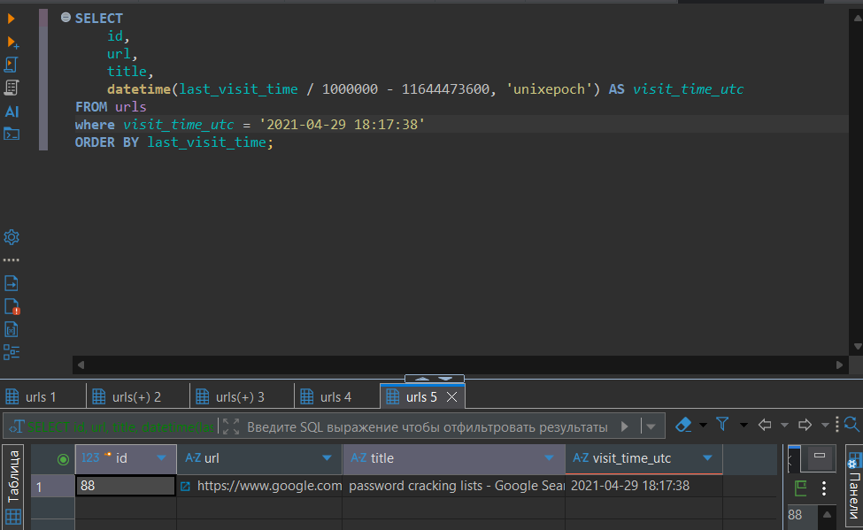
*Figure 2 – Chrome `urls` entry `id = 88` records the Google search `password cracking lists - Google Search` at `2021-04-29 18:17:38 UTC`.*

Reviewing consolidated browser activity in **BrowsingHistoryView** confirmed immediate follow-on visits to the `danielmiessler/SecLists` GitHub repository (`Passwords` and `Common-Credentials` directories) and subsequent webmail authentication to **ProtonMail**:

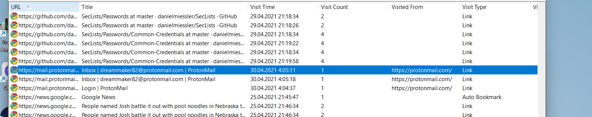
*Figure 3 – Browser history showing visits to `SecLists/Passwords` and `SecLists/Passwords/Common-Credentials` (`29.04.2021 21:18:26`–`21:19:58` local time) and ProtonMail login/inbox access for **`dreammaker82@protonmail.com`** (`30.04.2021 04:04:37`–`04:05:18` local time).*

**Why this is dangerous:** Directly pivoting from a `password cracking lists` search to `SecLists/Passwords/Common-Credentials` demonstrates active preparation for credential-stuffing or brute-force attacks, while encrypted ProtonMail (`dreammaker82@protonmail.com`) provides an off-band communications channel.

## 3. Deleted Artifacts & Anonymization Tooling — Recycle Bin & Tor Browser Prefetch

Inspecting the Windows Recycle Bin in **FTK Imager** exposed a deleted password wordlist pair (`$IW9BJ2Z.txt` metadata and `$RW9BJ2Z.txt` file content, `754` bytes):

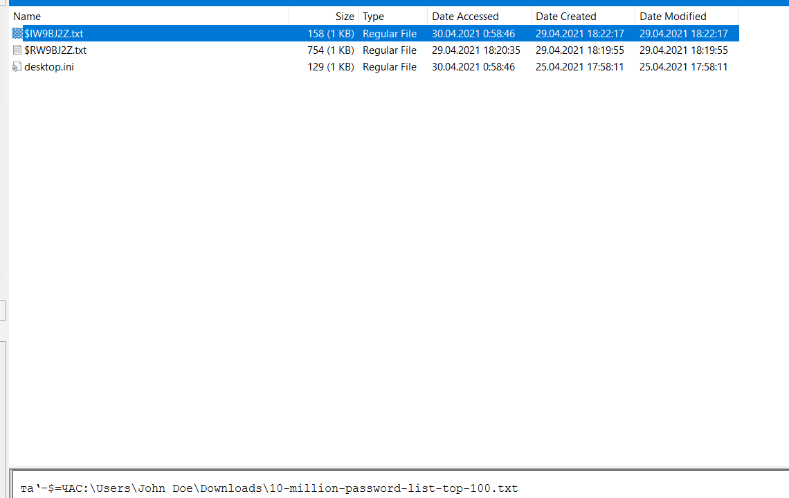
*Figure 4 – `$IW9BJ2Z.txt` (`Created/Modified: 29.04.2021 18:22:17`) records the original path `C:\Users\John Doe\Downloads\10-million-password-list-top-100.txt`, confirming the user downloaded the wordlist from SecLists (`18:19:55`) and deleted it less than three minutes later.*

Parsing Windows Prefetch artifacts with **PECmd** (`TORBROWSER-INSTALL-WIN64-10.0-F3C4DF19.pf`) confirmed execution of the Tor Browser installer just 15 seconds after the wordlist was recycled:

```cmd
PECmd.exe -f C:\Артефакты\TORBROWSER-INSTALL-WIN64-10.0-F3C4DF19.pf
```

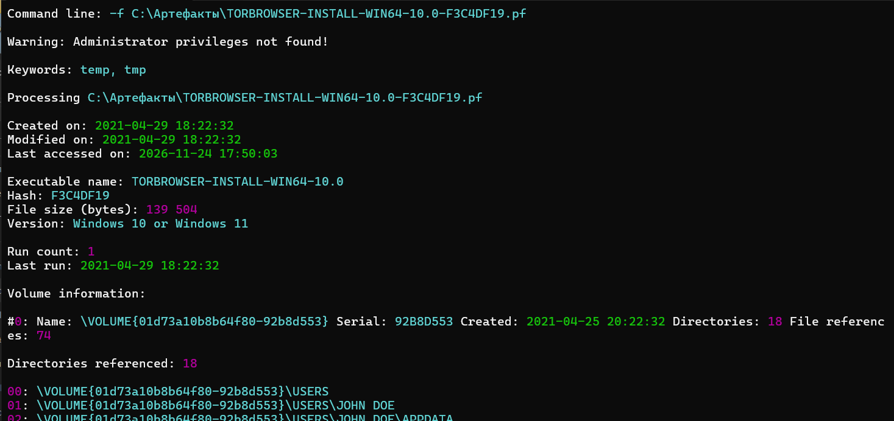
*Figure 5 – `TORBROWSER-INSTALL-WIN64-10.0` (hash `F3C4DF19`, size `139,504` bytes, Windows 10/11 Prefetch format) executed once (`Run count: 1`) at `2021-04-29 18:22:32` on volume `\VOLUME{01d73a10b8b64f80-92b8d553}` (serial `92B8D553`), referencing `\USERS\JOHN DOE\APPDATA`.*

**Why this is dangerous:** Rapidly deleting downloaded attack wordlists and installing **Tor Browser** indicates conscious operational security (OPSEC) and intent to mask subsequent network activity.

## 4. Network & File Transfer Artifacts — FileZilla Slack Space & FTP Server Configuration

Searching extracted FileZilla directory files and file slack for IPv4 addresses using `grep` recovered residual Chromium QUIC JSON metadata embedded inside `default_auto16x16.png.FileSlack`:

```bash
grep -arE '([0-9]{1,3}\.){3}[0-9]{1,3}' .
```

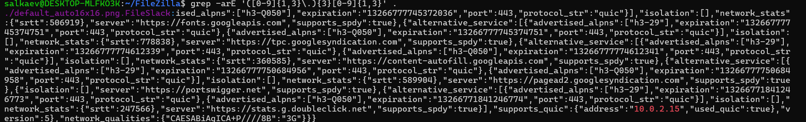
*Figure 6 – `./default_auto16x16.png.FileSlack` contains residual QUIC transport metadata listing `"supports_quic":{"address":"10.0.2.15","used_quic":true}` alongside a reference to `https://portswigger.net`.*

Examining FileZilla's configuration folder (`FileZilla3 version="3.53.1"`) in **FTK Imager** revealed an active FTP server entry in `recentservers.xml` (created `29.04.2021 16:04:18`, modified `30.04.2021 01:01:26`):

```xml
<?xml version="1.0" encoding="UTF-8"?>
<FileZilla3 version="3.53.1" platform="windows">
    <RecentServers>
        <Server>
            <Host>192.168.1.20</Host>
            <Port>21</Port>
            <Protocol>0</Protocol>
            <Type>0</Type>
            <User>kali</User>
            <Logontype>2</Logontype>
```

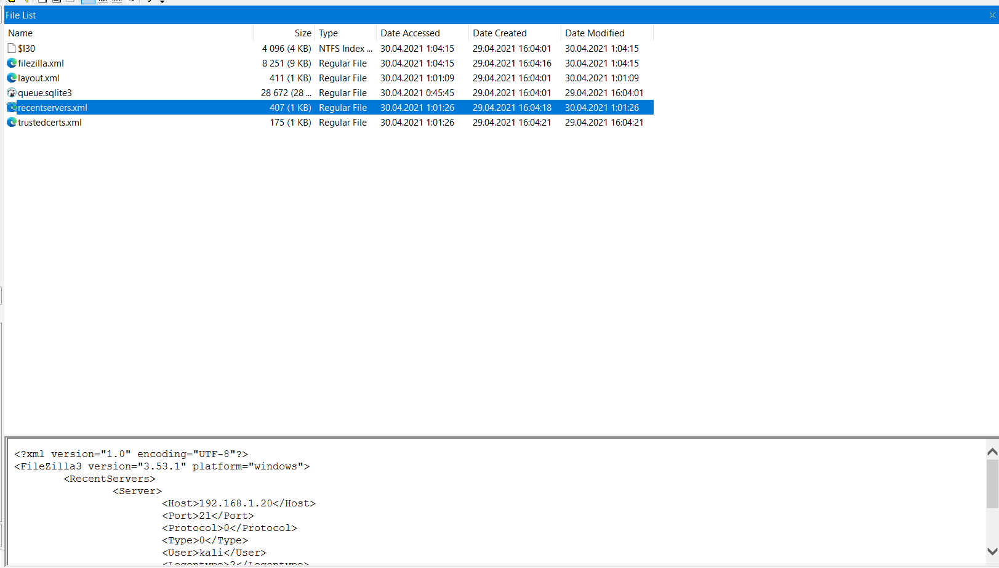
*Figure 7 – `recentservers.xml` (`407` bytes) documents an FTP (`Protocol: 0`, port `21`) connection to **`192.168.1.20`** authenticating as user **`kali`**.*

**Why this is dangerous:** FileZilla staging to an internal host (`192.168.1.20`) under the username `kali` — combined with `portswigger.net` (Burp Suite vendor) and VirtualBox NAT IP (`10.0.2.15`) remnants in slack space — strongly indicates interaction with a dedicated offensive attack VM and potential file exfiltration or tool transfer.

## 5. Command-Line Reconnaissance & Anti-Forensics — PowerShell History

Reviewing PowerShell command history (`ConsoleHost_history.txt`) exposed active target scanning, DNS cache flushing, and deliberate secure file wiping via Sysinternals `sdelete`:

```powershell
sdelete
ipconfig
ipconfig /cleardns
ipconfig /flushdns
exit
sdelete
exit
ipconfig /flushdns
ping dfir.science
nmap dfir.science
dir
cd .\Documentsdir
sdelete .ccountNum
```

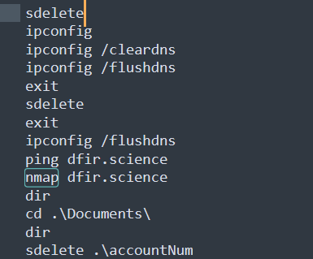
*Figure 8 – PowerShell history recording network reconnaissance (`ping dfir.science`, `nmap dfir.science`), repeated DNS cache clearing (`ipconfig /flushdns`), and targeted secure deletion of `.\Documents\accountNum` using `sdelete`.*

**Why this is dangerous:** Running `nmap` against an external target (`dfir.science`) confirms active reconnaissance, while invoking `ipconfig /flushdns` and `sdelete .\accountNum` demonstrates deliberate anti-forensic destruction of potentially sensitive account records and volatile network evidence.

## 6. Mobile Device & Geolocation Correlation — Autopsy Images, EXIF GPS & ShellBags

Reviewing image artifacts in **Autopsy** (`175 Results`) surfaced a burst of smartphone photos captured on `2021-04-29` (including `20210429_151943.jpg` through `20210429_152321.jpg`), from which `20210429_152043.jpg` (`7,985,612` bytes) was extracted for metadata inspection:

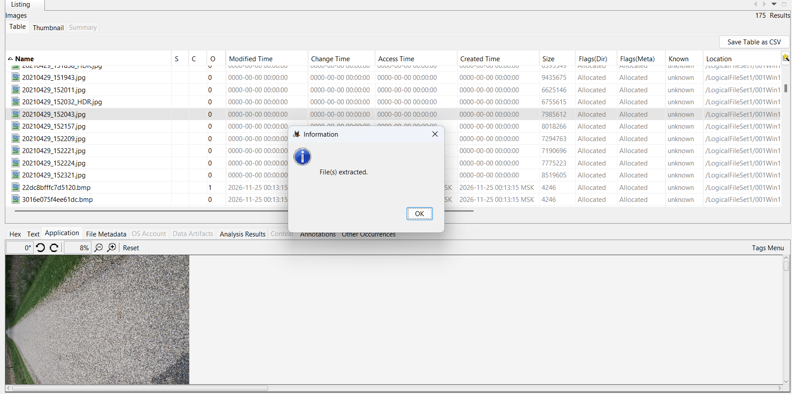
*Figure 9 – Autopsy media listing showing extracted photo `20210429_152043.jpg` (`7,985,612` bytes) alongside adjacent `20210429_15xxxx.jpg` captures.*

Parsing the EXIF metadata of `20210429_152043.jpg` pinpointed exact GPS coordinates and camera hardware details:

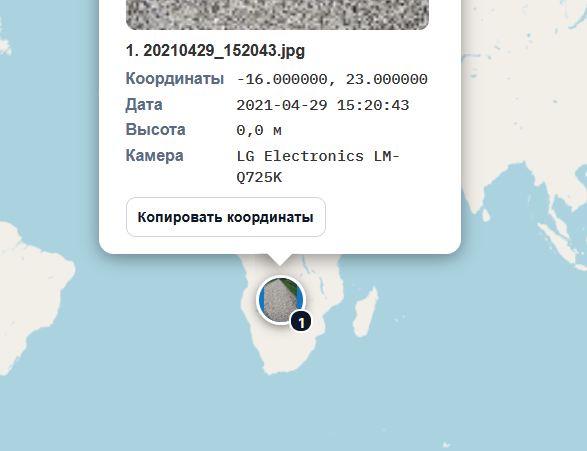
*Figure 10 – EXIF metadata for `20210429_152043.jpg`:*
- **GPS Coordinates:** `-16.000000, 23.000000` (Southern Africa / Western Zambia region; altitude `0.0 m`).
- **Capture Timestamp:** `2021-04-29 15:20:43`.
- **Camera Device:** `LG Electronics LM-Q725K` (LG Q7).

Corroborating this camera model against Windows user registry artifacts in **ShellBags Explorer** (`v2026.5.0`) confirmed an **LG Q7** smartphone was physically connected over MTP and browsed directly into its `DCIM\Camera` folder:

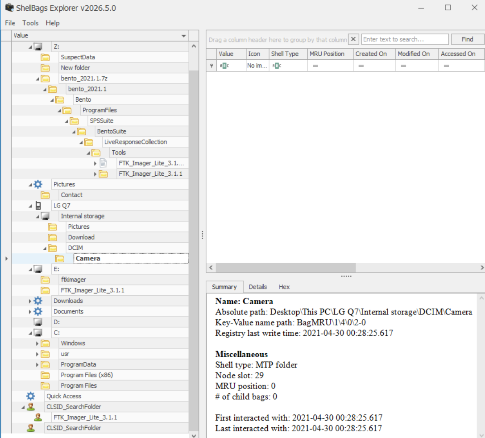
*Figure 11 – ShellBags entry `BagMRU\1\4\0\2-0` (`Shell type: MTP folder`) records interaction with `Desktop\This PC\LG Q7\Internal storage\DCIM\Camera` on `2021-04-30 00:28:25.617`.*

**Analyst takeaway:** Cross-correlating EXIF camera metadata (`LG Electronics LM-Q725K`) with MTP ShellBags (`LG Q7\Internal storage\DCIM\Camera`) establishes physical linkage between the workstation, the suspect's mobile phone, and the geotagged imagery (`-16.000000, 23.000000`).

## 7. Registry Recovery & Credential Analysis — Transaction Logs, SAM Dump & Hashcat

Because the extracted `SYSTEM` registry hive was dirty, I first replayed its primary and secondary transaction logs (`SYSTEM.LOG1`, `SYSTEM.LOG2`) with **regipy** to produce a clean hive (`SYSTEM_clean`):

```bash
regipy-process-transaction-logs ./SYSTEM -p ./SYSTEM.LOG1 -s ./SYSTEM.LOG2 -o ./SYSTEM_clean
```

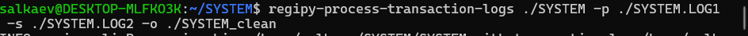
*Figure 12 – Replaying `SYSTEM` registry transaction logs into `./SYSTEM_clean` prior to offline credential extraction.*

Running **Impacket `secretsdump.py`** (`v0.13.1`) against the `SAM` hive and repaired `SYSTEM_clean` hive extracted the system BootKey (`0xba508bdf20f883c63e72ad2c4d9f6fe2`) and local account NTLM hashes:

```bash
secretsdump.py -sam ~/SAMandSYSTEM/SAM -system ./SYSTEM_clean LOCAL
```

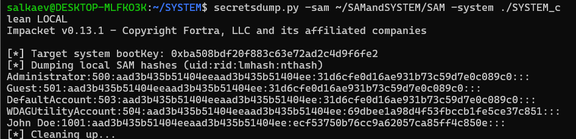
*Figure 13 – Offline SAM extraction revealing local user `John Doe` (RID `1001`) with NT hash `ecf53750b76cc9a62057ca85ff4c850e` (alongside `WDAGUtilityAccount` RID `504` `69dbee1a98d4f53fbccb1fe5ce37c851` and empty-hash built-in accounts).*

For offline NTLM credential auditing, **Hashcat** (`v8.0.0-235-gf1407e4`, mode `1000` NTLM) was executed with a 7-character mask (`?a?a?a?a?a?a!`) against target NTLM digest `3de1a36f6ddb8e036dfd75e8e20c4af4`, achieving recovery in `22` seconds at `812.7 MH/s`:

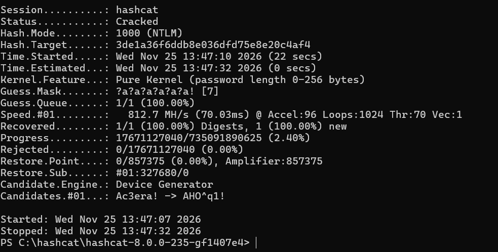
*Figure 14 – Hashcat (`Mode 1000` NTLM) reporting `Status: Cracked` (`1/1` digests recovered in `22 secs`, mask `?a?a?a?a?a?a! [7]`) for `3de1a36f6ddb8e036dfd75e8e20c4af4`.*

**Analyst takeaway:** Replaying dirty registry transaction logs (`SYSTEM.LOG1`/`.LOG2`) is essential for reliable offline `secretsdump.py` extraction, and fast NTLM mask recovery highlights the weakness of short 7-character local passwords.

## 8. Investigation Summary

| Artifact | Finding |
|----------|---------|
| Forensic Image | `DiskDrigger.ad1` (`MD5: 9471e69c95d8909ae60ddff30d50ffa1`, `SHA1: 167aa08db25dfeeb876b0176ddc329a3d9f2803a`) |
| Suspect Account & Email | Local user `John Doe` (RID `1001`); ProtonMail `dreammaker82@protonmail.com` |
| Wordlist & Browser Activity | Google search `password cracking lists` (`2021-04-29 18:17:38 UTC`); GitHub `danielmiessler/SecLists` |
| Deleted Artifact | `C:\Users\John Doe\Downloads\10-million-password-list-top-100.txt` (`$IW9BJ2Z.txt`, deleted `2021-04-29 18:22:17`) |
| Anonymization Installer | `TORBROWSER-INSTALL-WIN64-10.0-F3C4DF19.pf` (`Run count: 1`, `2021-04-29 18:22:32`) |
| FileZilla & Slack Artifacts | FTP `192.168.1.20:21` (user `kali`) in `recentservers.xml`; `10.0.2.15` & `portswigger.net` in `default_auto16x16.png.FileSlack` |
| PowerShell Commands | `ping dfir.science`, `nmap dfir.science`, `ipconfig /flushdns`, `sdelete .\accountNum` |
| Mobile & EXIF Geolocation | `20210429_152043.jpg` (`-16.000000, 23.000000`, `LG Electronics LM-Q725K`); MTP ShellBag `LG Q7\Internal storage\DCIM\Camera` (`2021-04-30 00:28:25.617`) |
| SAM / NTLM Credentials | BootKey `0xba508bdf20f883c63e72ad2c4d9f6fe2`; `John Doe` NT hash `ecf53750b76cc9a62057ca85ff4c850e`; cracked NTLM target `3de1a36f6ddb8e036dfd75e8e20c4af4` |

## Indicators of Compromise

| Type | Value |
|------|-------|
| Forensic Image MD5 / SHA1 | `9471e69c95d8909ae60ddff30d50ffa1` / `167aa08db25dfeeb876b0176ddc329a3d9f2803a` |
| Suspect Email Address | `dreammaker82@protonmail.com` |
| Remote FTP Server & User | `192.168.1.20:21` (user `kali`) |
| Slack-Space IPv4 & Domain | `10.0.2.15` / `https://portswigger.net` |
| Scanned Target Domain | `dfir.science` |
| Deleted Wordlist | `10-million-password-list-top-100.txt` (`$IW9BJ2Z.txt` / `$RW9BJ2Z.txt`) |
| Executed Tooling | `TORBROWSER-INSTALL-WIN64-10.0`, `nmap`, `sdelete` |
| Local User NTLM Hash | `John Doe:1001` — `ecf53750b76cc9a62057ca85ff4c850e` |

## MITRE ATT&CK Mapping

| Technique | ID | Description |
|-----------|----|-------------|
| Active Scanning: Scanning IP Blocks / Host Discovery | T1595 | `ping dfir.science` and `nmap dfir.science` recorded in PowerShell `ConsoleHost_history.txt`. |
| Obtain Capabilities: Tool / Wordlist Acquisition | T1588 | Google search for `password cracking lists`, visits to `danielmiessler/SecLists`, and download of `10-million-password-list-top-100.txt`. |
| Proxy: Multi-hop Proxy | T1090.003 | Execution of `TORBROWSER-INSTALL-WIN64-10.0` (`F3C4DF19`) observed in Windows Prefetch. |
| Exfiltration Over Alternative Protocol / File Transfer | T1048 | FileZilla FTP configuration (`recentservers.xml`) connecting to `192.168.1.20:21` as user `kali`. |
| Indicator Removal: File Deletion | T1070.004 | Recycle Bin deletion of `10-million-password-list-top-100.txt` and targeted wiping of `.\Documents\accountNum` via `sdelete`, plus `ipconfig /flushdns`. |

## Remediation & Lessons Learned

1. **Correlate volatile, deleted, and slack-space artifacts across timelines** — combining Chrome SQLite timestamps, Recycle Bin `$I` files, Prefetch (`PECmd`), PowerShell history, and file slack (`grep`) reconstructs attacker intent even after `sdelete` and DNS cache flushing.
2. **Restrict unauthorized offensive tooling and anonymizers** — enforce application allowlisting (WDAC/AppLocker) to block unauthorized binaries such as `nmap`, `sdelete`, FileZilla, and Tor Browser installers on standard user workstations, and alert on PowerShell `ConsoleHost_history.txt` anomalies.
3. **Investigate peer infrastructure (`192.168.1.20`) and monitor removable/MTP media** — preserve and triage the remote FTP host (`192.168.1.20`, user `kali`) for staged data (`accountNum`), and enforce DLP/USB device controls to audit MTP phone transfers (`LG Q7`).
4. **Always replay registry transaction logs and harden local authentication** — process `.LOG1`/`.LOG2` files with `regipy` before dumping `SAM`/`SYSTEM` hives, and enforce strong password length/complexity policies to prevent rapid GPU NTLM mask cracking.
