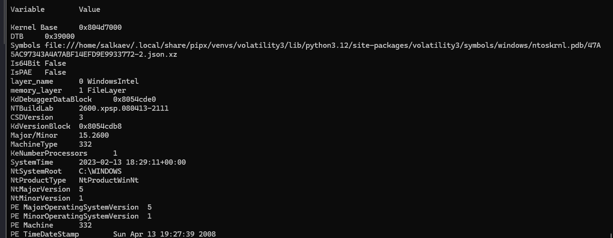
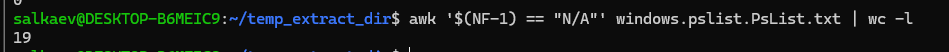
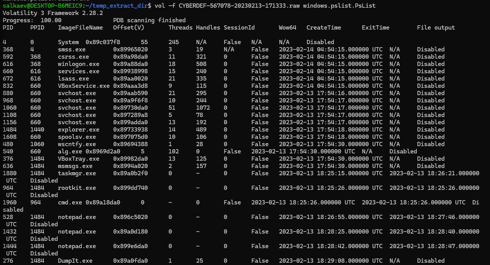
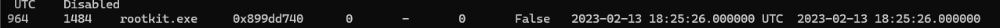
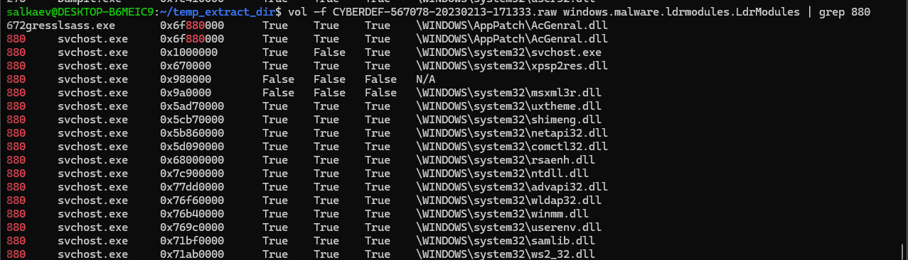

# BlackEnergy Rootkit Memory Forensics — Investigating Process & Module Anomalies on Windows XP SP3

**Incident Type:** Rootkit / Stealth & Process Anomaly Investigation (BlackEnergy)
**Date:** November 21, 2026
**Status:** Completed
**Environment:** CyberDefenders – *BlackEnergy Lab* (simulated SOC/IR exercise)

## Executive Summary

A Windows memory image (`CYBERDEF-567078-20230213-171333.raw`) was submitted for forensic triage following suspected rootkit and stealth activity. Using **Volatility 3** (`windows.info`, `windows.pslist`, `windows.malware.ldrmodules.LdrModules`, and handle inspection) alongside command-line filtering (`awk`), I profiled the host environment, evaluated process counts and exit states, inspected suspiciously named processes (`rootkit.exe`), traced kernel driver handles (`str.sys`), and checked `svchost.exe` (PID `880`) for unlinked or injected modules.

Analysis confirmed the memory capture came from a 32-bit **Windows XP Service Pack 3** (`5.1`, build `2600.xpsp.080413-2111`, non-PAE) host at `2023-02-13 18:29:11 UTC`. Triage identified `19` entries with `N/A` in the second-to-last column (`ExitTime` / active-state indicator in the exported `windows.pslist.PsList.txt` output), a short-lived `rootkit.exe` process (PID `964`, PPID `1484`, launched and exited at `2023-02-13 18:25:26 UTC` after spawning `cmd.exe` PID `1960`), a handle to `\Device\HarddiskVolume1\WINDOWS\system32\drivers\str.sys` associated with `svchost.exe` (PID `880`), and an unlinked memory region at base `0x980000` (`InLoad: False`, `InInit: False`, `InMem: False`, `MappedPath: N/A`) inside `svchost.exe` (PID `880`).

## Investigation Workflow

1. **System & Kernel Profiling** – identify the OS version, architecture, PAE status, and capture timestamp from kernel structures.
2. **Process Enumeration & Filtering** – count `N/A` entries in exported `windows.pslist.PsList.txt` and inspect active vs. exited processes in `windows.pslist.PsList`.
3. **Suspicious Process & Driver Triage** – examine `rootkit.exe` (PID `964`) and check open driver handles (`str.sys`).
4. **Module Unlinking & Injection Analysis** – audit loaded and unlinked DLLs in `svchost.exe` (PID `880`) using `windows.malware.ldrmodules.LdrModules`.
5. **Remediation & Hunting** – validate suspicious drivers/DLLs, hunt for rootkit artifacts, and harden endpoint monitoring.

---

## 1. System & Kernel Profiling — Windows XP SP3 (`x86`, Non-PAE)

Inspecting kernel metadata and PDB symbol resolution established the exact baseline of the memory dump (`CYBERDEF-567078-20230213-171333.raw`):


*Figure 1 – Key system parameters from the dump profile:*
- **OS & Build:** Windows XP (`NtMajorVersion: 5`, `NtMinorVersion: 1`, `Major/Minor: 15.2600`, `NTBuildLab: 2600.xpsp.080413-2111`, `CSDVersion: 3` / Service Pack 3).
- **Architecture & PAE:** 32-bit (`Is64Bit: False`, `MachineType: 332` / `0x014c`), `IsPAE: False` (`layer_name: WindowsIntel`), `Kernel Base: 0x804d7000`, `DTB: 0x39000`.
- **Capture Time:** `2023-02-13 18:29:11+00:00` (`KeNumberProcessors: 1`, `NtSystemRoot: C:\WINDOWS`).

**Analyst takeaway:** Confirming `5.1` (`x86`, Service Pack 3, `IsPAE: False`) ensures accurate structure offsets and avoids misinterpreting legacy Windows XP kernel artifacts.

## 2. Process Listing & Filtering — Counting `N/A` Entries and Reviewing Activity

Filtering the exported `windows.pslist.PsList.txt` output with `awk` for `"N/A"` in the second-to-last column (`$(NF-1)`) returned a count of `19`:

```bash
awk '$(NF-1) == "N/A"' windows.pslist.PsList.txt | wc -l
```


*Figure 2 – `awk '$(NF-1) == "N/A"' windows.pslist.PsList.txt | wc -l` outputs **`19`**.*

Running `windows.pslist.PsList` directly against `CYBERDEF-567078-20230213-171333.raw` displayed core system processes (`System` PID `4`, `smss.exe` PID `368`, `csrss.exe` PID `592`, `winlogon.exe` PID `616`, `services.exe` PID `660`, `lsass.exe` PID `672`, `explorer.exe` PID `1484`), multiple `svchost.exe` instances (including PIDs `880` and `968`), several exited processes (`taskmgr.exe`, `rootkit.exe`, `cmd.exe`, and `notepad.exe` instances), and `DumpIt.exe` (PID `276`, launched `18:29:08 UTC`):

```bash
vol -f CYBERDEF-567078-20230213-171333.raw windows.pslist.PsList
```


*Figure 3 – `windows.pslist.PsList` output showing core Windows services, `svchost.exe` instances (PIDs `880`, `968`, `1060`, `1108`, `1156`), exited processes with non-null `ExitTime`, and `DumpIt.exe` (PID `276`).*

## 3. Suspicious Process & Driver Artifacts — `rootkit.exe` and `str.sys`

Isolating the `rootkit.exe` entry in `pslist` highlighted a brief execution window spawned from `explorer.exe` (PID `1484`):


*Figure 4 – `rootkit.exe` (PID `964`, PPID `1484`, offset `0x899dd740`) has both `CreateTime` and `ExitTime` recorded at `2023-02-13 18:25:26.000000 UTC` (with `cmd.exe` PID `1960` also showing PPID `964` at `18:25:26 UTC` in the process list).*

Inspection of open handles also surfaced a handle (`0x340`, `File`, `0x12019f`) associated with `svchost.exe` (PID `880`) pointing to a driver file in the system drivers directory:


*Figure 5 – Handle artifact referencing `\Device\HarddiskVolume1\WINDOWS\system32\drivers\str.sys` alongside `svchost.exe` (PID `880`, object `0x89af0cf0`).*

**Why this is dangerous:** An explicitly named `rootkit.exe` spawning `cmd.exe`, combined with a non-standard driver path (`\WINDOWS\system32\drivers\str.sys`) tied to a shared `svchost.exe` host process, points to stealth/rootkit tooling or driver staging on the endpoint.

## 4. Module Unlinking Check — `LdrModules` on `svchost.exe` (PID `880`)

To see whether `svchost.exe` (PID `880`) contained DLLs missing from standard PEB loader lists (`InLoadOrderModuleList`, `InMemoryOrderModuleList`, `InInitializationOrderModuleList`), I ran `windows.malware.ldrmodules.LdrModules` filtered for PID `880`:

```bash
vol -f CYBERDEF-567078-20230213-171333.raw windows.malware.ldrmodules.LdrModules | grep 880
```


*Figure 6 – `windows.malware.ldrmodules.LdrModules` for PID `880` (`svchost.exe`), showing standard modules (`ntdll.dll`, `advapi32.dll`, `ws2_32.dll`, `AcGenral.dll`, `xpsp2res.dll`, `msxml3r.dll`, etc.) alongside an entry with `False` across all three loader lists.*

Focusing on the unlinked entry at base address `0x980000` confirmed it does not appear in any PEB list and has no mapped file path:


*Figure 7 – Entry at `0x980000` in `svchost.exe` (PID `880`) shows `InLoad: False`, `InInit: False`, `InMem: False`, and `MappedPath: N/A`.*

**Why this is dangerous:** Attackers and rootkits frequently unlink malicious DLLs from PEB module lists or inject code into memory regions without a backing file path (`MappedPath: N/A`) so casual process/module listings miss the payload hosted inside a legitimate `svchost.exe` process.

## 5. Investigation Summary

| Artifact | Finding |
|----------|---------|
| Memory Image | `CYBERDEF-567078-20230213-171333.raw` (captured `2023-02-13 18:29:11 UTC`) |
| Target OS & Profile | Windows XP SP3 (`5.1`, build `2600.xpsp.080413-2111`, `x86`, `IsPAE: False`) |
| `awk` Filter Count | `19` lines matching `$(NF-1) == "N/A"` in `windows.pslist.PsList.txt` |
| Suspicious Process | `rootkit.exe` (PID `964`, PPID `1484`, `18:25:26 UTC`; child `cmd.exe` PID `1960`) |
| Driver Artifact | `\Device\HarddiskVolume1\WINDOWS\system32\drivers\str.sys` (associated with PID `880` `svchost.exe`) |
| Unlinked Module in PID `880` | Base `0x980000` (`InLoad: False`, `InInit: False`, `InMem: False`, `MappedPath: N/A`) |

## Indicators of Compromise

| Type | Value |
|------|-------|
| Suspicious Executable | `rootkit.exe` (PID `964`, PPID `1484`) |
| Driver File Path | `\Device\HarddiskVolume1\WINDOWS\system32\drivers\str.sys` |
| Unlinked Memory Base | `0x980000` in `svchost.exe` (PID `880`, `MappedPath: N/A`) |

## MITRE ATT&CK Mapping

| Technique | ID | Description |
|-----------|----|-------------|
| Rootkit | T1014 | Execution of `rootkit.exe`, driver artifact `str.sys`, and module hiding/unlinking techniques. |
| Reflective Code Loading / Process Injection | T1055 | Unlinked module entry at `0x980000` (`False` across `InLoad`, `InInit`, `InMem`) inside `svchost.exe` (PID `880`). |
| Command and Scripting Interpreter: Windows Command Shell | T1059.003 | `cmd.exe` (PID `1960`) observed with parent PID `964` (`rootkit.exe`) at `18:25:26 UTC`. |

## Remediation & Lessons Learned

1. **Isolate and rebuild the compromised host** — rootkits and kernel-level modifications compromise host trust at the OS/driver level; contain the system, extract remaining artifacts (`str.sys`, VAD/memory regions around `0x980000`), and reimage from known-good media.
2. **Audit `svchost.exe` and non-standard drivers** — hunt across endpoints for `str.sys`, unexpected `svchost.exe` child processes or memory injections, and unsigned/unusual drivers in `\WINDOWS\system32\drivers\`.
3. **Combine `pslist` with `ldrmodules` and handle/driver checks** — a standard process list alone may only show brief `CreateTime`/`ExitTime` windows (`rootkit.exe`), whereas `LdrModules` and handle inspection expose hidden/unlinked modules (`0x980000`) and backing driver files (`str.sys`).
