# Insider Threat Disk Forensics — Investigating a Rogue Kali Linux Workstation

**Incident Type:** Insider Threat / Host Disk Forensics
**Date:** November 16, 2026
**Status:** Completed
**Environment:** CyberDefenders – *Insider Lab* (simulated SOC/IR exercise)

## Executive Summary

Following a suspected insider threat incident involving an employee workstation, a forensic disk image (`Horcrux.E01`, ext4 partition) was acquired for offline examination. The goal was to establish the operating system environment, verify whether web services had been actively accessed, identify offensive security tools downloaded onto the machine, reconstruct command-line and privilege-escalation activity, and recover artifacts revealing the insider's intentions and targeting of a colleague ("Bob").

Forensic analysis using **FTK Imager**, standard Linux CLI hashing tools, and log review confirmed that the host (`KarenHacker`) was running **Kali Linux**. Although the Apache web server logs (`/var/log/apache2/access.log`) were completely empty (`0 KB`, MD5 `d41d8cd98f00b204e9800998ecf8427e`), the disk contained compelling evidence of insider preparation and reconnaissance: a downloaded credential-dumping archive (`mimikatz_trunk.zip`), an explicit attack `Checklist` targeting Bob, `.bash_history` entries showing Metasploit (`msfconsole`) and steganography inspection (`binwalk`), a custom bash reconnaissance script, `auth.log` records of `su` to `postgres` and `sudo visudo` from `/root/Documents/myfirsthack`, and a captured desktop screenshot (`irZLAohL.jpeg`) of Bob's Windows machine running **AlphaSOC Network Flight Simulator** (`aylmao.exe`) alongside a Notepad window containing `flag<REDBULL_IS_LIFE>`.

## Investigation Workflow

1. **OS & Scope Identification** – confirm the Linux distribution and forensic objectives.
2. **Web Service Log Verification** – inspect `/var/log/apache2/` and hash `access.log` to check for web activity.
3. **Malicious Tooling Discovery** – locate downloaded offensive tools (`mimikatz_trunk.zip`) and extracted folders.
4. **Command History Analysis** – examine `/root/.bash_history` for executed offensive tools, hidden files, and steganography activity.
5. **User Documents & Intent Artifacts** – inspect personal notes (`Checklist`), custom bash scripts, and captured image files (`irZLAohL.jpeg`).
6. **Authentication & Privilege Log Review** – parse `/var/log/auth.log` for user switching (`su`), `sudo` commands, working directories, and reboots.
7. **Remediation** – revoke insider access, audit Bob's workstation, and harden privilege/monitoring controls.

---

## 1. Environment Identification & Investigation Scope

Initial triage of the disk image confirmed the suspect machine was running **Kali Linux** (`kali`), a penetration-testing distribution pre-loaded with offensive tooling.

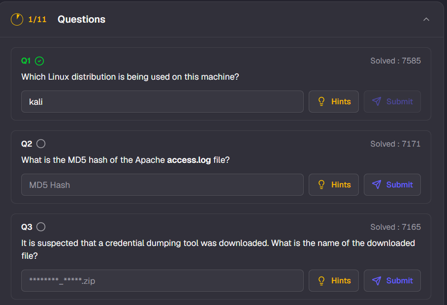
*Figure 1 – Initial scope confirmation identifying the OS distribution as `kali` and setting the first verification targets: hashing Apache's `access.log` and locating the downloaded credential-dumping archive.*

## 2. Apache Web Log Verification — Confirming Empty `access.log`

To check whether the insider had been hosting payloads or serving HTTP traffic from the Kali workstation, I extracted Apache's `access.log` and computed its MD5 hash:

```bash
md5sum access.log
```

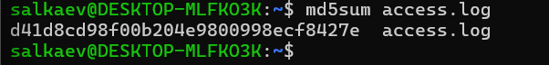
*Figure 2 – `md5sum access.log` returns `d41d8cd98f00b204e9800998ecf8427e`, the canonical MD5 hash of a zero-byte file.*

Cross-checking `/var/log/apache2/` directly inside **FTK Imager** confirmed that `access.log`, `error.log`, and `other_vhosts_access.log` were all `0 KB` (last modified `09.11.2017 13:41:05`, created on disk `14.03.2019 3:23:31`), ruling out active Apache web delivery on this host:

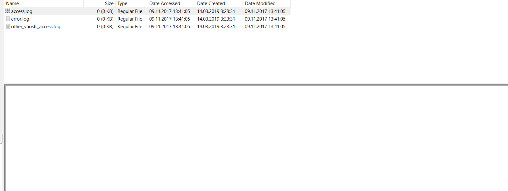
*Figure 3 – All three Apache log files in FTK Imager show `0 (0 KB)`, corroborating the empty-file MD5 hash.*

## 3. Credential Dumping Tooling — `mimikatz_trunk.zip`

Searching the filesystem for offensive archives surfaced **`mimikatz_trunk.zip`**, a widely abused Windows credential-harvesting utility capable of extracting plaintext passwords, NTLM hashes, and Kerberos tickets from LSASS memory:

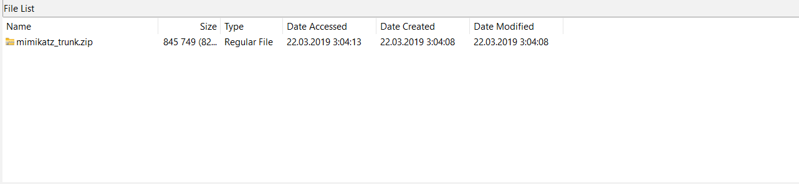
*Figure 4 – `mimikatz_trunk.zip` (`845,749` bytes), created and modified on `22.03.2019 3:04:08` and accessed five seconds later at `3:04:13`.*

**Why this is dangerous:** Mimikatz is a Windows post-exploitation tool — finding it downloaded and unpacked on a Linux host indicates the insider was staging tools specifically to compromise Windows systems on the network (such as Bob's machine).

## 4. Command History Analysis — `.bash_history`

Examining `/root/.bash_history` (`1,435` bytes, last modified `22.03.2019 5:48:44`) revealed direct evidence of offensive framework usage and manual file manipulation:

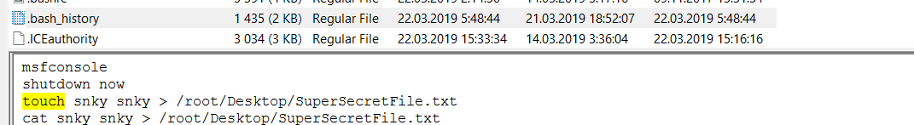
*Figure 5 – `.bash_history` shows `msfconsole` (Metasploit Framework), `shutdown now`, and creation of `/root/Desktop/SuperSecretFile.txt` via `touch snky snky > /root/Desktop/SuperSecretFile.txt` and `cat snky snky > /root/Desktop/SuperSecretFile.txt`.*

Further down in the command log, the insider exported their shell history and ran **`binwalk`** against a suspicious JPEG image — a standard method for inspecting or extracting hidden data embedded inside images:

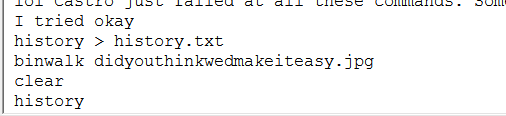
*Figure 6 – Commands include `history > history.txt`, `binwalk didyouthinkwedmakeiteasy.jpg`, `clear`, and `history` — alongside informal text lines indicating trial-and-error execution.*

## 5. Insider Intent — The `Checklist` File

Inside the same directory where `mimikatz` had been extracted (`22.03.2019 3:04:50`), a `60`-byte plaintext file named `Checklist` (`22.03.2019 4:18:50`) documented the insider's objectives explicitly:

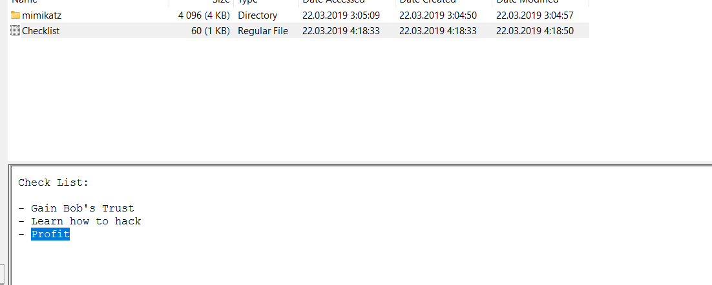
*Figure 7 – Contents of `Checklist`: `- Gain Bob's Trust`, `- Learn how to hack`, `- Profit`.*

**Analyst takeaway:** Establishing intent is often the hardest part of an insider threat investigation. Paired with the `mimikatz` extraction timestamp roughly an hour earlier (`03:04`), this note links the technical tool staging directly to a deliberate plan targeting colleague Bob.

## 6. Compromised Target Artifact — Screenshot of Bob's Desktop (`irZLAohL.jpeg`)

Reviewing recovered image artifacts revealed **`irZLAohL.jpeg`**, a full screenshot of Bob's Windows workstation captured at `1:38 AM` on `3/22/2019`:

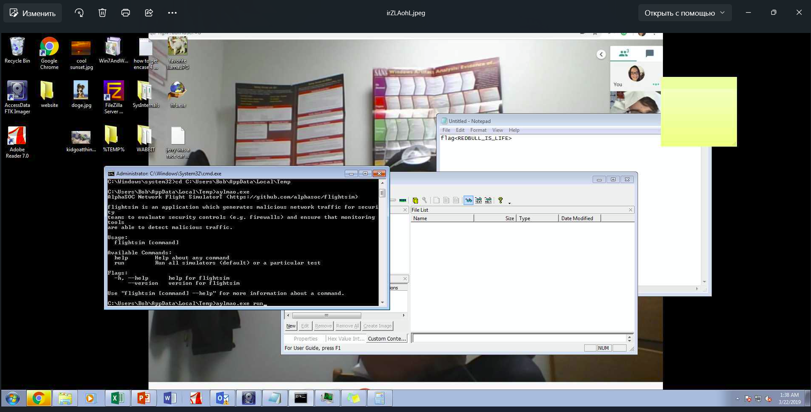
*Figure 8 – `irZLAohL.jpeg` shows an active Windows desktop (with FTK Imager, FileZilla Server, SysInternals, and `hfs.exe` on the desktop), an open Notepad window displaying `flag<REDBULL_IS_LIFE>`, and an elevated `cmd.exe` console running `C:\Users\Bob\AppData\Local\Temp\aylmao.exe run`.*

**Why this is dangerous:** The binary `aylmao.exe` outputs banner text identifying it as **AlphaSOC Network Flight Simulator** (`https://github.com/alphasoc/flightsim`), a utility designed to generate simulated malicious network traffic to test security controls. In an insider scenario, running a traffic simulator under a disguised filename (`aylmao.exe`) from `Bob`'s `%TEMP%` directory can either test SOC detection coverage ahead of a real attack or flood monitoring alerts with decoy noise to mask genuine malicious activity.

## 7. Custom Reconnaissance Script in `/root`

Inspecting scripts stored inside `/root` on the mounted `Horcrux.E01` ext4 partition uncovered a custom bash script written to check basic host and network state:

```bash
echo "Showing you your current path"
pwd
echo "Show my default route"
ip route | grep --color default
echo "Show network connections w/ port 80"
netstat | grep --color 80
echo "Heck yeah! I can write bash too Young"
```

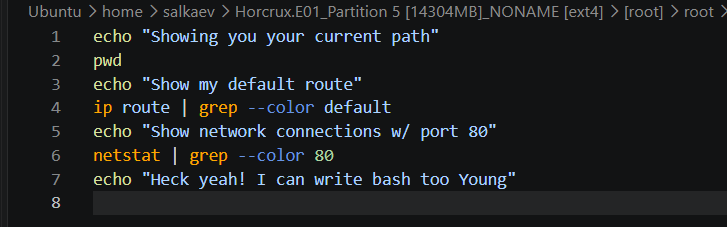
*Figure 9 – Custom bash script inside `Horcrux.E01_Partition 5 / [root] / root`, enumerating working directory, default gateway route, and port `80` network connections.*

## 8. Authentication & Privilege Logs — `/var/log/auth.log`

Finally, auditing `/var/log/auth.log` established the system hostname (**`KarenHacker`**) and reconstructed privileged account activity across March 20–21:

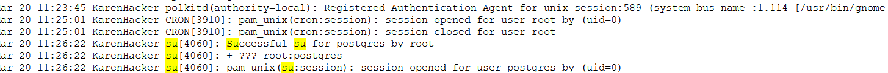
*Figure 10 – On `Mar 20 11:26:22`, `root` successfully switched user to `postgres` (`su[4060]: Successful su for postgres by root`), consistent with initializing or interacting with the PostgreSQL database used by Metasploit.*

The next day's entries revealed privilege configuration edits (`visudo`) executed from a telltale working directory (`/root/Documents/myfirsthack`), followed by novice package-manager commands and a system reboot:

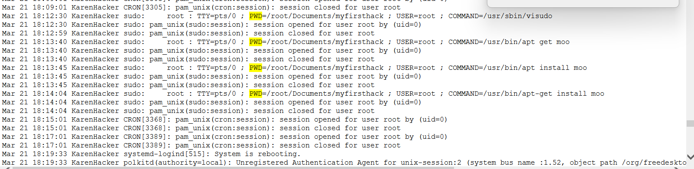
*Figure 11 – On `Mar 21`, `root` executed `sudo /usr/sbin/visudo` (`18:12:30`), followed by `apt get moo`, `apt install moo`, and `apt-get install moo` (`18:13:40`–`18:14:04`) from `PWD=/root/Documents/myfirsthack`, before rebooting at `18:19:33`.*

## 9. Investigation Summary

| Artifact / Question | Finding |
|---------------------|---------|
| Linux Distribution | Kali Linux (`kali`) |
| Hostname | `KarenHacker` |
| Apache `access.log` MD5 | `d41d8cd98f00b204e9800998ecf8427e` (`0 KB`, empty) |
| Credential Dumping Tool | `mimikatz_trunk.zip` (extracted to `mimikatz/`) |
| Insider Intent Note | `Checklist` (`Gain Bob's Trust`, `Learn how to hack`, `Profit`) |
| Key `.bash_history` Activity | `msfconsole`, `SuperSecretFile.txt`, `binwalk didyouthinkwedmakeiteasy.jpg` |
| Target Desktop Artifact | `irZLAohL.jpeg` — Bob's desktop running `aylmao.exe` (`flightsim`) + `flag<REDBULL_IS_LIFE>` |
| Suspicious Working Directory | `/root/Documents/myfirsthack` |
| Auth Log Highlights | `su` to `postgres` (`Mar 20 11:26:22`), `sudo /usr/sbin/visudo` (`Mar 21 18:12:30`) |

## Indicators of Compromise

| Type | Value |
|------|-------|
| Hostname | `KarenHacker` |
| Offensive Archive | `mimikatz_trunk.zip` |
| Suspicious Files | `/root/Desktop/SuperSecretFile.txt`, `didyouthinkwedmakeiteasy.jpg`, `Checklist`, `irZLAohL.jpeg` |
| Working Directory | `/root/Documents/myfirsthack` |
| Disguised Simulator Binary (Bob's Host) | `C:\Users\Bob\AppData\Local\Temp\aylmao.exe` (AlphaSOC `flightsim`) |
| Apache `access.log` MD5 | `d41d8cd98f00b204e9800998ecf8427e` |

## MITRE ATT&CK Mapping

| Technique | ID | Description |
|-----------|----|-------------|
| OS Credential Dumping | T1003 | Downloaded and extracted `mimikatz_trunk.zip` for Windows credential theft. |
| Screen Capture | T1113 | Recovered screenshot (`irZLAohL.jpeg`) capturing Bob's active desktop and Notepad window. |
| Abuse Elevation Control Mechanism: Sudo and Sudo Caching | T1548.003 | Modified or inspected sudoers configuration via `sudo /usr/sbin/visudo`. |
| System Network Configuration Discovery | T1016 | Custom bash script queried `ip route` and `netstat` for routing and port `80` connections. |
| Obfuscated Files or Information: Steganography | T1027.003 | Used `binwalk` to inspect `didyouthinkwedmakeiteasy.jpg` for embedded data. |

## Remediation & Lessons Learned

1. **Preserve forensic evidence and coordinate with HR/Legal** — maintain chain of custody for `Horcrux.E01` and revoke all network, VPN, and physical access for the suspect insider account.
2. **Audit Bob's workstation immediately** — inspect `C:\Users\Bob\AppData\Local\Temp\aylmao.exe`, check for unauthorized Mimikatz execution or LSASS access (Sysmon Event ID `10`), and rotate Bob's domain and local credentials.
3. **Inspect `/etc/sudoers` changes** — review exact modifications made during the `Mar 21 18:12:30` `visudo` session to ensure no backdoor privilege grants remain on managed Linux assets.
4. **Restrict unauthorized penetration-testing distributions** — enforce network access control (802.1X / NAC) so unmanaged Kali Linux machines cannot plug into corporate VLANs undetected.
5. **Correlate multiple artifact classes** — combining empty web logs, shell history, auth logs, plaintext notes, and recovered images built a complete behavioral profile that no single log source could have shown alone.
