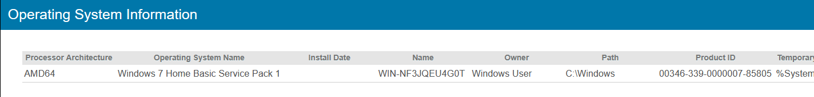
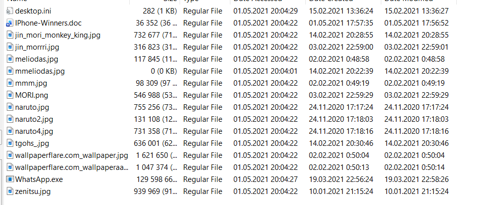

# Phishy Disk Forensics — Investigating Phishing Document Artifacts on Windows 7 SP1

**Incident Type:** Phishing / Suspicious Document Triage (Phishy)
**Date:** November 28, 2026
**Status:** Completed
**Environment:** CyberDefenders – *Phishy Lab* (simulated SOC/IR exercise)

## Executive Summary

A Windows disk image was submitted for forensic triage following suspected phishing activity. Using **Autopsy** for operating system profiling and **FTK Imager** for filesystem inspection and MACB timestamp review, I established the baseline host profile and audited user files for social-engineering lures, anomalous timestamps, and suspicious executables.

Analysis confirmed the host ran 64-bit **Windows 7 Home Basic Service Pack 1** (`AMD64`, computer name `WIN-NF3JQEU4G0T`, owner `Windows User`, Product ID `00346-339-0000007-85805`, system root `C:\Windows`). Directory triage surfaced a suspicious legacy Microsoft Word document named `IPhone-Winners.doc` (`36,352` bytes) alongside benign anime wallpaper images and `WhatsApp.exe` (`~129.6 MB`). Notably, `IPhone-Winners.doc` exhibits a `Date Modified` (`01.05.2021 17:56:52`) that predates its `Date Created` (`01.05.2021 17:57:35`) by 43 seconds, consistent with a phishing attachment downloaded or copied onto the endpoint rather than authored locally.

## Investigation Workflow

1. **System & OS Profiling** – identify the operating system version, processor architecture, hostname, owner, and installation paths from Autopsy host metadata.
2. **User Directory & File Triage** – enumerate regular files, file sizes, and MACB timestamps (`Date Created`, `Date Modified`, `Date Accessed`) in FTK Imager to separate benign user media from suspicious artifacts.
3. **Phishing Lure & Timestamp Anomaly Analysis** – isolate `IPhone-Winners.doc` and evaluate its lure naming, legacy `.doc` format, and `Modified < Created` NTFS timestamp signature.
4. **Remediation & Hunting** – analyze the document safely in a sandbox, hunt for macro/child-process execution, and address end-of-life OS exposure.

---

## 1. System & OS Profiling — Windows 7 Home Basic SP1 (`AMD64`)

Reviewing the Autopsy **Operating System Information** report established the baseline host environment for the forensic image:

*Figure 1 – Key system parameters from the Autopsy OS profile:*
- **OS & Service Pack:** `Windows 7 Home Basic Service Pack 1` (`AMD64` / 64-bit).
- **Host & Owner:** Computer Name `WIN-NF3JQEU4G0T`, Owner `Windows User`.
- **System Path & Product ID:** `C:\Windows`, Product ID `00346-339-0000007-85805`.

**Analyst takeaway:** Confirming a legacy **Windows 7 SP1** (`AMD64`) host immediately elevates risk severity, as end-of-life Windows 7 systems lack modern security patches and exploit mitigations against weaponized Office documents.

## 2. User File Triage & Suspicious Lure Artifact — `IPhone-Winners.doc`

Inspecting the user file listing revealed 16 regular files consisting primarily of anime wallpaper images (`naruto.jpg`, `naruto2.jpg`, `naruto4.jpg`, `zenitsu.jpg`, `meliodas.jpg`, `mmeliodas.jpg`, `mmm.jpg`, `MORI.png`, `jin_mori_monkey_king.jpg`, `jin_morrri.jpg`, `tgohs_.jpg`, `wallpaperflare.com_wallpaper.jpg`, `wallpaperflare.com_wallpaperaa...`), `desktop.ini`, and `WhatsApp.exe` (created `19.03.2021 22:56:24`, modified `19.03.2021 22:58:26`), alongside one clear phishing lure — `IPhone-Winners.doc`:

*Figure 2 – File listing highlighting `IPhone-Winners.doc` (`36,352` bytes) created on `01.05.2021 17:57:35`, modified on `01.05.2021 17:56:52`, and accessed on `01.05.2021 20:04:22` alongside benign user images and `WhatsApp.exe`.*

Key observations from the file metadata:
- **Social-engineering filename & format:** `IPhone-Winners.doc` uses a classic prize/giveaway lure delivered as a legacy binary Word format (`.doc`), commonly used to embed VBA macros or OLE/RTF exploits.
- **NTFS timestamp signature (`Modified < Created`):** `Date Modified` (`01.05.2021 17:56:52`) precedes `Date Created` (`01.05.2021 17:57:35`) by 43 seconds, indicating the file was written via download, email attachment save, or volume copy rather than created locally from scratch.
- **Clustered access timestamps:** Nearly all files in the directory share a `Date Accessed` timestamp of `01.05.2021 20:04:22` (ranging `20:04:01` to `20:04:29`), reflecting directory browsing or forensic collection activity later that day.

**Why this is dangerous:** Legacy `.doc` prize-lure files (`IPhone-Winners.doc`) are a staple initial-access vector for malicious VBA macros, DDE payloads, and Office memory-corruption exploits — especially hazardous on an unpatched Windows 7 SP1 endpoint.

## 3. Investigation Summary

| Artifact | Finding |
|----------|---------|
| Target OS & Architecture | Windows 7 Home Basic Service Pack 1 (`AMD64`) |
| Hostname & Owner | `WIN-NF3JQEU4G0T` / `Windows User` |
| System Root & Product ID | `C:\Windows` / `00346-339-0000007-85805` |
| Suspicious Phishing Lure | `IPhone-Winners.doc` (`36,352` bytes) |
| Lure Timestamps | Modified `01.05.2021 17:56:52`, Created `01.05.2021 17:57:35`, Accessed `01.05.2021 20:04:22` |
| Other Notable User Files | `WhatsApp.exe` (`~129.6 MB`, created `19.03.2021 22:56:24`) and benign `.jpg`/`.png` wallpapers |

## Indicators of Compromise

| Type | Value |
|------|-------|
| Suspicious Document | `IPhone-Winners.doc` (`36,352` bytes) |
| Affected Hostname | `WIN-NF3JQEU4G0T` |
| OS Product ID | `00346-339-0000007-85805` |

## MITRE ATT&CK Mapping

| Technique | ID | Description |
|-----------|----|-------------|
| Phishing: Spearphishing Attachment | T1566.001 | Presence of a prize-themed legacy Word lure (`IPhone-Winners.doc`) with a download/copy-in timestamp pattern (`Modified < Created`). |
| User Execution: Malicious File | T1204.002 | Social-engineering lure filename designed to entice the user into opening the document and triggering embedded macros or exploits. |

## Remediation & Lessons Learned

1. **Perform static and sandboxed analysis on `IPhone-Winners.doc`** — extract the file from the image and inspect OLE streams, VBA macros (`olevba` / `oleid`), embedded URLs, and Zone.Identifier ADS to determine the delivery source and follow-on payload.
2. **Block legacy Office macro execution and hunt across endpoints** — disable macros from the internet via Group Policy, alert on Office processes (`WINWORD.EXE`) spawning scripting or shell utilities, and sweep email gateways for `IPhone-Winners.doc` variants.
3. **Decommission or isolate end-of-life Windows 7 endpoints** — migrate `WIN-NF3JQEU4G0T` off Windows 7 SP1 to a supported, patched operating system with modern EDR and Attack Surface Reduction (ASR) rules enabled.
