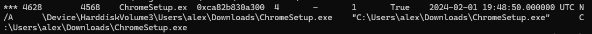
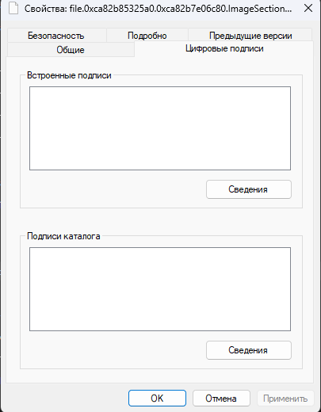
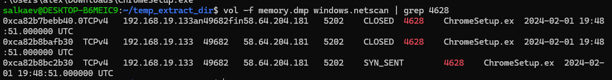
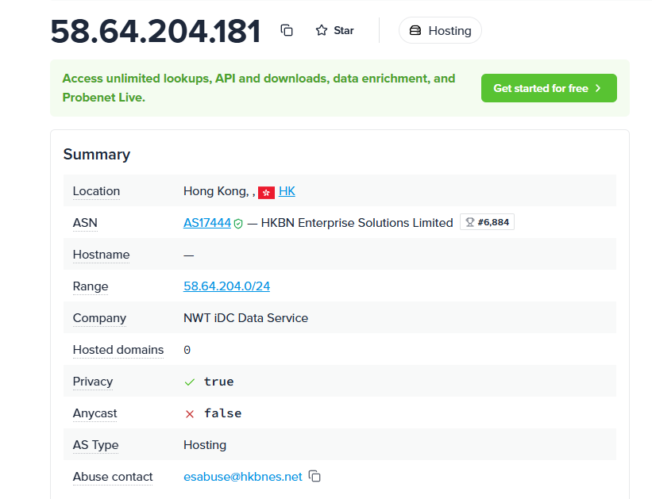
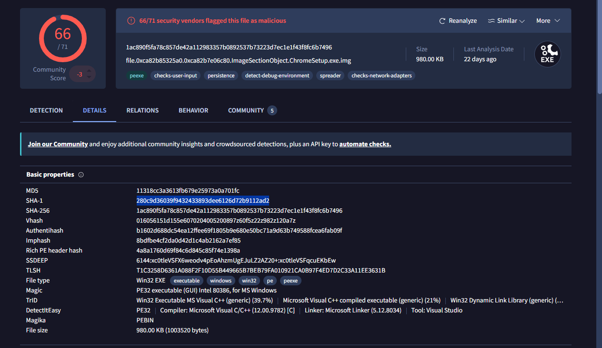
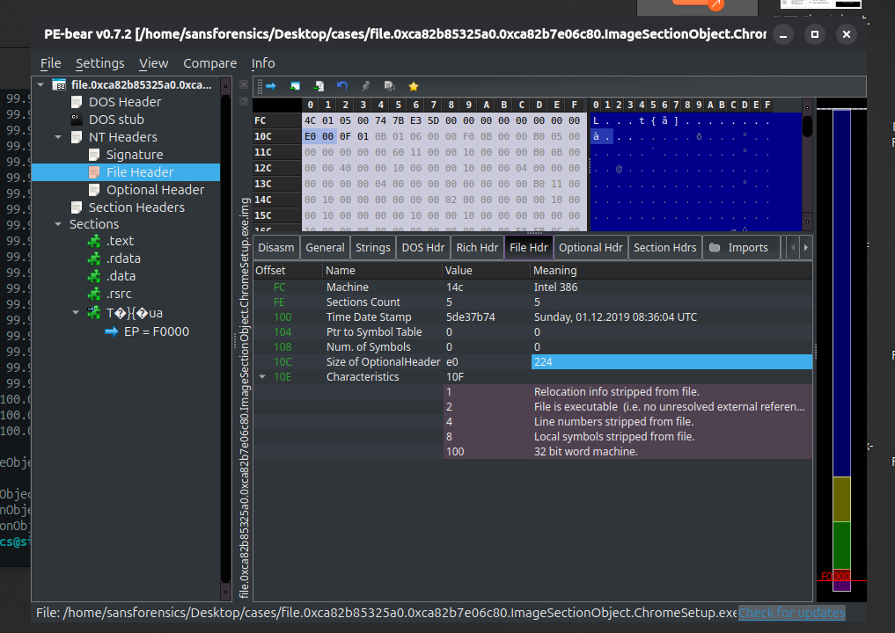
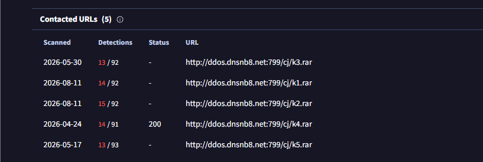

# Ramnit Malware Analysis — Memory Forensics & Static PE Triage of Masqueraded `ChromeSetup.exe`

**Incident Type:** Malware Infection / Trojanized Installer & PE Infector (Ramnit)
**Date:** November 20, 2026
**Status:** Completed
**Environment:** CyberDefenders – *Ramnit Lab* (simulated SOC/IR exercise)

## Executive Summary

An endpoint belonging to user **`alex`** (`192.168.19.133`) exhibited suspicious outbound network behavior shortly after a browser installer (`ChromeSetup.exe`) was executed from the Downloads folder. Using **Volatility 3** on the acquired memory dump (`memory.dmp`), combined with static PE inspection (**PE-bear**) and threat intelligence enrichment (**VirusTotal**, **IPinfo**), I reconstructed the infection and profiled the payload.

Forensic analysis confirmed that `C:\Users\alex\Downloads\ChromeSetup.exe` (PID `4628`, launched `2024-02-01 19:48:50 UTC`) was **not** a legitimate Google Chrome installer: the dumped binary lacked any digital signature, initiated an outbound TCP connection just one second after launch (`19:48:51 UTC`) to a Hong Kong hosting IP (`58.64.204.181:5202`), scored **66/71 detections** on VirusTotal, and exhibited classic **Ramnit** PE-infection traits — including a garbled 5th PE section (`T}{ua`) containing the hijacked entry point (`EP = F0000`), a compilation timestamp of `2019-12-01 08:36:04 UTC`, and five secondary payload URLs hosted at `http://ddos.dnsnb8.net:799/cj/k1.rar`–`k5.rar`.

## Investigation Workflow

1. **Process & Command-Line Triage** – identify suspicious executables launched from user-writable folders (`Downloads`).
2. **Binary Extraction & Signature Check** – dump the executable from memory and verify Authenticode digital signatures.
3. **Network Connection Analysis** – inspect active and closed sockets associated with the suspect PID via `windows.netscan`.
4. **IP Threat Intelligence Enrichment** – determine geolocation, ASN, and hosting infrastructure for the C2 IP.
5. **Hash & Reputation Lookup** – submit the extracted binary's cryptographic hashes to VirusTotal and review behavioral tags.
6. **Static PE Header Inspection** – analyze compilation timestamp, sections, and entry point anomalies in PE-bear.
7. **Secondary Infrastructure Mapping** – collect contacted URLs and staging domains for network blocking.

---

## 1. Process Triage — Suspicious `ChromeSetup.exe` Execution

Enumerating processes and command lines from `memory.dmp` surfaced a 32-bit executable (`Wow64: True`) masquerading as the Google Chrome installer running directly from user `alex`'s Downloads folder:

```bash
vol -f memory.dmp windows.pstree
vol -f memory.dmp windows.cmdline
```


*Figure 1 – `ChromeSetup.exe` (PID `4628`, PPID `4568`, offset `0xca82b830a300`, `4` threads) launched at `2024-02-01 19:48:50 UTC` from `\Device\HarddiskVolume3\Users\alex\Downloads\ChromeSetup.exe`.*


*Figure 2 – `windows.cmdline` confirms direct invocation of `"C:\Users\alex\Downloads\ChromeSetup.exe"` with no command-line arguments.*

## 2. Binary Extraction & Digital Signature Verification

After dumping the image section object from memory (`file.0xca82b85325a0.0xca82b7e06c80.ImageSectionObject.ChromeSetup.exe.img`) using Volatility's `windows.dumpfiles`, I checked its Windows Authenticode signature properties:


*Figure 3 – Both Embedded Signatures ("Встроенные подписи") and Catalog Signatures ("Подписи каталога") are completely empty.*

**Why this is dangerous:** Official `ChromeSetup.exe` installers distributed by Google are always validly signed by **Google LLC**. An unsigned installer carrying a trusted vendor filename is an immediate high-confidence indicator of masquerading (`T1036.005`) or binary trojanization.

## 3. Network Activity — Immediate C2 Beacon to `58.64.204.181:5202`

Next, I filtered Volatility's network scan output specifically for PID `4628`:

```bash
vol -f memory.dmp windows.netscan | grep 4628
```


*Figure 4 – One second after launch (`2024-02-01 19:48:51 UTC`), `ChromeSetup.exe` (PID `4628`) initiated TCPv4 connections from `192.168.19.133:49682` to **`58.64.204.181:5202`** (`CLOSED` and `SYN_SENT` states).*

**Why this is dangerous:** A legitimate browser installer communicates with Google CDN infrastructure over HTTPS (`443`), never directly to a raw IP address on non-standard TCP port `5202` within one second of launch.

## 4. C2 Infrastructure Enrichment — IPinfo Lookup

Querying `58.64.204.181` on **IPinfo** identified the hosting provider and geographic origin of the C2 endpoint:


*Figure 5 – `58.64.204.181` resolves to **Hong Kong (HK)** under **AS17444** (`HKBN Enterprise Solutions Limited`, company `NWT iDC Data Service`, subnet `58.64.204.0/24`, AS Type: `Hosting`, abuse contact `esabuse@hkbnes.net`).*

## 5. Threat Intelligence Enrichment — VirusTotal Analysis

Looking up the dumped binary on **VirusTotal** overwhelmingly confirmed maliciousness (**66/71** security vendors):


*Figure 6 – VirusTotal flags the `980.00 KB` (`1,003,520` bytes) Win32 PE executable (`SHA-256: 1ac890f5fa78c857de42a112983357b0892537b73223d7ec1e1f43f8fc6b7496`, `SHA-1: 280c9d36039f9432433893dee6126d72b9112ad2`, `MD5: 11318cc3a3613fb679e25973a0a701fc`) with tags `checks-user-input`, `persistence`, `detect-debug-environment`, `spreader`, and `checks-network-adapters`.*

## 6. Static PE Header Analysis — PE-bear

Inspecting the dumped executable in **PE-bear v0.7.2** exposed the internal structural anomalies characteristic of the **Ramnit** file infector / banking trojan family:


*Figure 7 – PE-bear File Header details:*
- **Machine:** `0x14c` (Intel 386, 32-bit)
- **Time Date Stamp:** `0x5de37b74` → **`Sunday, 01.12.2019 08:36:04 UTC`**
- **Sections Count:** `5` — standard `.text`, `.rdata`, `.data`, `.rsrc`, plus an anomalous 5th section with a garbled name (`T}{ua`) hosting the hijacked Entry Point (**`EP = F0000`**).

**Why this is dangerous:** Legitimate compilers place the program Entry Point inside `.text`. Appending an obfuscated final section and redirecting the PE Entry Point to that appended section (`EP = F0000`) is a textbook signature of **Ramnit** infecting an otherwise benign PE binary so the malicious stub runs first before handing control back to the host executable.

## 7. Secondary Payload Infrastructure — Contacted URLs

Reviewing VirusTotal's **Relations → Contacted URLs** tab uncovered an additional staging server hosting compressed follow-on payloads:


*Figure 8 – Five malicious URLs contacted on **`ddos.dnsnb8.net:799`**: `http://ddos.dnsnb8.net:799/cj/k1.rar` through `k5.rar` (13–15/92 detections each, with `k4.rar` returning HTTP `200`).*

## 8. Investigation Summary

| Artifact | Finding |
|----------|---------|
| Compromised Host / User | `192.168.19.133` / `alex` |
| Malicious Process | `ChromeSetup.exe` (PID `4628`, PPID `4568`, launched `2024-02-01 19:48:50 UTC`) |
| Full Disk Path | `C:\Users\alex\Downloads\ChromeSetup.exe` |
| Digital Signature | Unsigned (no embedded or catalog signatures) |
| Compilation Timestamp | `2019-12-01 08:36:04 UTC` (`0x5de37b74`) |
| PE Anomaly | Obfuscated 5th section (`T}{ua`) containing hijacked Entry Point (`EP = F0000`) |
| C2 IP & Port | `58.64.204.181:5202` (Hong Kong, AS17444 – HKBN Enterprise Solutions / NWT iDC Data Service) |
| Secondary Payload Domain | `ddos.dnsnb8.net:799` (`/cj/k1.rar` – `/cj/k5.rar`) |
| Malware Family | Ramnit |

## Indicators of Compromise

| Type | Value |
|------|-------|
| File Name & Path | `C:\Users\alex\Downloads\ChromeSetup.exe` |
| MD5 | `11318cc3a3613fb679e25973a0a701fc` |
| SHA-1 | `280c9d36039f9432433893dee6126d72b9112ad2` |
| SHA-256 | `1ac890f5fa78c857de42a112983357b0892537b73223d7ec1e1f43f8fc6b7496` |
| Imphash | `8bdfbe4cf2da0d42d1c4ab2162a7ef85` |
| C2 IP & Port | `58.64.204.181:5202` |
| Contacted Staging URLs | `http://ddos.dnsnb8.net:799/cj/k1.rar`, `k2.rar`, `k3.rar`, `k4.rar`, `k5.rar` |

## MITRE ATT&CK Mapping

| Technique | ID | Description |
|-----------|----|-------------|
| Masquerading: Match Legitimate Name or Location | T1036.005 | Malware disguised itself as `ChromeSetup.exe` without a valid Google LLC digital signature. |
| User Execution: Malicious File | T1204.002 | User `alex` executed the trojanized installer from `Downloads`. |
| Non-Standard Port | T1571 | Outbound C2 communication targeted raw IP `58.64.204.181` over TCP port `5202` and staging payloads over port `799`. |
| Ingress Tool Transfer | T1105 | Secondary RAR payload archives (`k1.rar`–`k5.rar`) retrieved from `ddos.dnsnb8.net:799`. |
| Virtualization/Sandbox Evasion / Debugger Evasion | T1497 | Behavioral indicators show anti-debug (`detect-debug-environment`) and user-input checks. |

## Remediation & Lessons Learned

1. **Quarantine and reimage the infected host** — Ramnit is a notorious file infector (`spreader` tag) capable of infecting other `.exe`, `.dll`, and `.html` files across local and removable drives. Simple deletion of `ChromeSetup.exe` is insufficient; full disk reimaging and network share scanning are required.
2. **Block C2 and staging infrastructure** — block `58.64.204.181` (all ports, specifically `5202`) and `ddos.dnsnb8.net` (port `799`) at DNS, firewall, and proxy layers, and add all three hashes (MD5/SHA-1/SHA-256) to EDR blocklists.
3. **Reset credentials for user `alex`** — Ramnit also functions as a banking/credential trojan; force password resets and invalidate active web sessions.
4. **Alert on unsigned software installers** — a quick Authenticode check immediately exposed `ChromeSetup.exe` as fake. EDR/SIEM rules flagging unsigned executables matching common installer names (`ChromeSetup.exe`, `Firefox Installer.exe`, etc.) in `Downloads` are high-signal and low-noise.
5. **Pair memory dumps with static PE inspection** — Volatility caught the network connection and process path, while dumping the image into PE-bear revealed the hijacked Entry Point in the 5th section (`EP = F0000`) and exact build timestamp (`2019-12-01`) needed to confirm PE infection.
