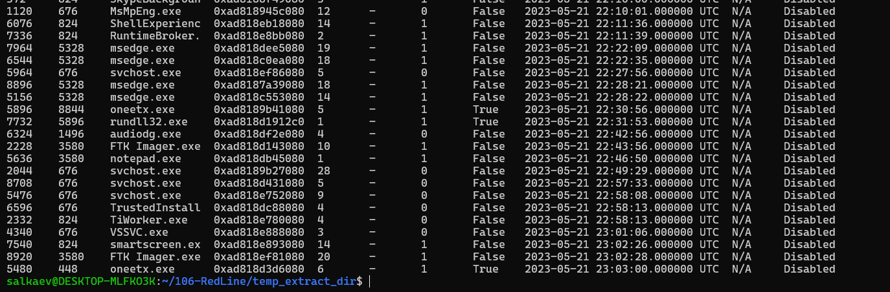
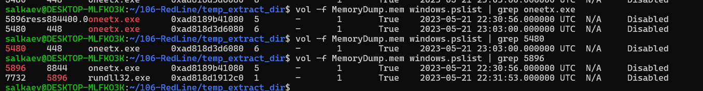
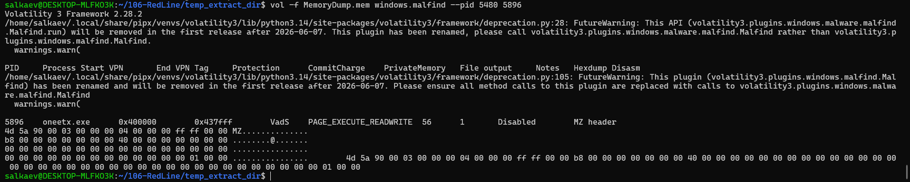
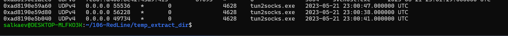
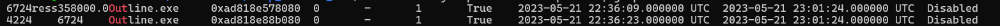
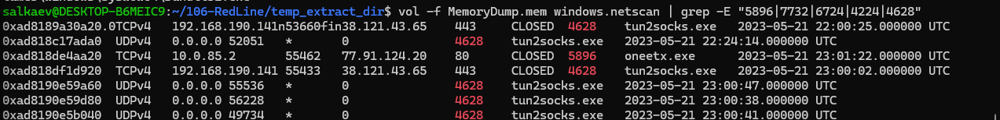
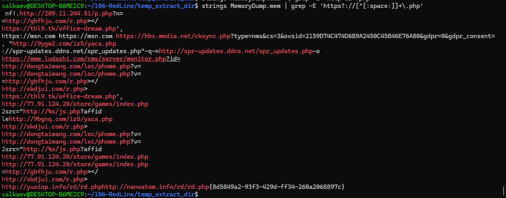
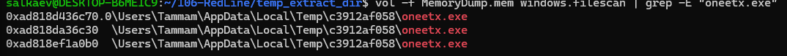

# RedLine Stealer Memory Forensics — Investigating Credential Theft & C2 Activity

**Incident Type:** Malware Infection / Infostealer (RedLine Stealer)
**Date:** November 5, 2026
**Status:** Completed
**Environment:** CyberDefenders – *RedLine Lab* (simulated SOC/IR exercise)

## Executive Summary

A Windows endpoint was flagged for suspicious outbound network activity and suspected credential theft. Memory acquisition was performed with FTK Imager, producing `MemoryDump.mem` for offline forensic analysis using **Volatility 3** and string extraction utilities.

The investigation followed a structured memory triage methodology: enumerate running and terminated processes, map parent–child process trees to isolate anomalous binaries, scan suspect process memory for code injection, correlate active and closed network sockets (accounting for VPN tunneling on the host), extract C2 URIs from memory strings, and locate the malicious binary on disk. Analysis confirmed a **RedLine Stealer** infection executing from `C:\Users\Tammam\AppData\Local\Temp\c3912af058\oneetx.exe` (PID `5896`), containing an injected PE image (`PAGE_EXECUTE_READWRITE` with an `MZ` header), spawning `rundll32.exe` (PID `7732`), and communicating over an active Outline VPN tunnel (`10.0.85.2`) with its command-and-control server at `77.91.124.20:80` (`http://77.91.124.20/store/games/index.php`).

## Investigation Workflow

1. **Process Enumeration** – list active and recently exited processes to spot unfamiliar binaries and execution timestamps.
2. **Process Hierarchy Mapping** – trace parent–child relationships for suspicious executables.
3. **Memory Injection Analysis** – inspect suspect PIDs with `windows.malfind` for injected or hollowed PE payloads.
4. **VPN & Network Correlation** – review network sockets with `windows.netscan`, distinguishing legitimate VPN infrastructure from attacker C2 traffic.
5. **C2 URI Extraction** – search raw memory strings for PHP endpoints matching the identified C2 IP address.
6. **Disk Artifact Recovery** – locate the full filesystem path of the malicious executable via `windows.filescan`.
7. **Remediation** – contain the endpoint, revoke exposed credentials, and block identified C2 infrastructure.

---

## 1. Process Enumeration — Spotting `oneetx.exe`

Starting with a baseline process listing against the acquired Windows memory dump (`MemoryDump.mem`) immediately surfaced an unfamiliar executable running alongside standard Windows processes (`MsMpEng.exe`, `svchost.exe`, `msedge.exe`) and the forensic acquisition tool (`FTK Imager.exe`):

```bash
vol -f MemoryDump.mem windows.pslist
```


*Figure 1 – `windows.pslist` output showing two instances of `oneetx.exe` (PIDs `5896` and `5480`), along with a `rundll32.exe` child process (PID `7732`) created less than a minute after the first `oneetx.exe` launch on `2023-05-21`.*

## 2. Process Hierarchy — Isolating Suspicious Execution Chains

Filtering `windows.pslist` specifically for `oneetx.exe` and its PIDs confirmed two separate launches and a suspicious child process:

```bash
vol -f MemoryDump.mem windows.pslist | grep oneetx.exe
vol -f MemoryDump.mem windows.pslist | grep 5480
vol -f MemoryDump.mem windows.pslist | grep 5896
```


*Figure 2 – PID `5896` (`oneetx.exe`, PPID `8844`, launched `2023-05-21 22:30:56 UTC`) spawned `rundll32.exe` (PID `7732`) at `22:31:53 UTC`. A second instance, PID `5480` (PPID `448`), launched later at `23:03:00 UTC`.*

**Why this is dangerous:** `oneetx.exe` is not a standard Windows binary, runs as a 32-bit (`Wow64: True`) executable in user session `1`, and directly spawns `rundll32.exe` — a classic sign of a loader or infostealer proxying execution or performing follow-on payload staging.

## 3. Code Injection Detection — `windows.malfind`

To check whether either `oneetx.exe` instance was unpacking or injecting code directly into memory, I ran Volatility's `windows.malfind` plugin against both PIDs:

```bash
vol -f MemoryDump.mem windows.malfind --pid 5480 5896
```


*Figure 3 – `windows.malfind` flags PID `5896` (`oneetx.exe`) at virtual memory range `0x400000`–`0x437fff` (`VadS`) with `PAGE_EXECUTE_READWRITE` permissions, `PrivateMemory: 1`, and a raw PE `MZ` header (`4d 5a 90 00...`).*

**Why this is dangerous:** Legitimate executable images mapped from disk do not normally occupy private `PAGE_EXECUTE_READWRITE` (RWX) memory regions starting with an `MZ` header. This pattern strongly indicates in-memory unpacking, reflective PE loading, or process hollowing — a staple evasion technique used by RedLine Stealer loaders to keep the real payload off disk and out of static antivirus scans.

## 4. Network & VPN Context — Identifying `Outline.exe` and `tun2socks.exe`

Before attributing every external IP address to malware, I reviewed network artifacts and related processes. The host showed active UDP sockets bound to `tun2socks.exe` (PID `4628`):

```bash
vol -f MemoryDump.mem windows.netscan
```


*Figure 4 – `tun2socks.exe` (PID `4628`) holding UDPv4 sockets (`0.0.0.0:55536`, `56228`, `49734`) between `23:00:38` and `23:00:47 UTC`.*

Checking the process list for the parent VPN application confirmed that the user had been running the **Outline VPN** client during the incident window:

```bash
vol -f MemoryDump.mem windows.pslist | grep Outline
```


*Figure 5 – `Outline.exe` (PID `6724`, PPID `3580`, and child PID `4224`) ran from `22:36:09 UTC` until exiting at `23:01:24 UTC`.*

**Analyst note:** Distinguishing `Outline.exe` / `tun2socks.exe` from the actual malware is critical during SOC triage. Without checking the process tree, an analyst could easily misclassify the VPN tunnel endpoint (`38.121.43.65:443`) as attacker infrastructure while missing the real C2 traffic routed inside the tunnel.

## 5. C2 Communication — Tracing `oneetx.exe` Outbound Traffic

Filtering `windows.netscan` for all relevant PIDs (`5896`, `7732`, `6724`, `4224`, `4628`) isolated the exact command-and-control connection initiated by `oneetx.exe`:

```bash
vol -f MemoryDump.mem windows.netscan | grep -E "5896|7732|6724|4224|4628"
```


*Figure 6 – While `tun2socks.exe` (PID `4628`) maintained the VPN tunnel from `192.168.190.141` to `38.121.43.65:443`, `oneetx.exe` (PID `5896`) initiated a TCPv4 connection from the virtual tunnel interface `10.0.85.2:55462` directly to **`77.91.124.20:80`** at `2023-05-21 23:01:22 UTC`.*

**Why this is dangerous:** `oneetx.exe` communicated over cleartext HTTP (port `80`) to a raw IP address (`77.91.124.20`) right before the Outline VPN client shut down (`23:01:24 UTC`). Routing over the host's active VPN interface (`10.0.85.2`) also means perimeter firewalls outside the host may only observe encrypted VPN traffic to `38.121.43.65:443`, making host-level telemetry and memory forensics essential to uncover the true destination.

## 6. Extracting C2 Endpoints from Memory Strings

To recover the exact URI requested on the C2 server, I ran `strings` across `MemoryDump.mem` filtering for `.php` URLs:

```bash
strings MemoryDump.mem | grep -E 'https?://[^[:space:]]+\.php'
```


*Figure 7 – Multiple references to **`http://77.91.124.20/store/games/index.php`** appear in memory, directly matching the C2 IP address (`77.91.124.20`) observed in `windows.netscan` for PID `5896`.*

**Why this is dangerous:** Disguising a C2 panel or exfiltration gate under an innocuous-looking path such as `/store/games/index.php` helps blend outbound HTTP POST requests into normal web browsing noise if inspected without IP reputation or process context.

## 7. Locating the Malicious Binary on Disk

Finally, I queried the kernel file object pool using `windows.filescan` to identify the exact on-disk location and compromised user profile:

```bash
vol -f MemoryDump.mem windows.filescan | grep -E "oneetx.exe"
```


*Figure 8 – Three file object references confirm the binary path: `\Users\Tammam\AppData\Local\Temp\c3912af058\oneetx.exe` (offsets `0xad818d436c70`, `0xad818da36c30`, `0xad818ef1a0b0`).*

**Why this is dangerous:** Executing from a randomly named subfolder inside `%LOCALAPPDATA%\Temp\` (`c3912af058`) is typical dropper/stealer behavior — users have full write and execute permissions there without triggering UAC elevation, and temporary directories are frequently overlooked during quick manual reviews.

## 8. Investigation Summary

| Artifact | Finding |
|----------|---------|
| Compromised User | `Tammam` |
| Malicious Executable | `oneetx.exe` (PID `5896`, PPID `8844`; second instance PID `5480`, PPID `448`) |
| Full File Path | `C:\Users\Tammam\AppData\Local\Temp\c3912af058\oneetx.exe` |
| Spawned Child Process | `rundll32.exe` (PID `7732`, created `2023-05-21 22:31:53 UTC`) |
| Memory Injection | RWX VAD (`0x400000`–`0x437fff`) with embedded `MZ` header in PID `5896` |
| Host VPN Software | `Outline.exe` (PIDs `6724`, `4224`) / `tun2socks.exe` (PID `4628`) → `38.121.43.65:443` |
| C2 Server & Endpoint | `77.91.124.20:80` → `http://77.91.124.20/store/games/index.php` |
| Malware Family | RedLine Stealer |

## Indicators of Compromise

| Type | Value |
|------|-------|
| Malicious Binary | `oneetx.exe` |
| File Path | `C:\Users\Tammam\AppData\Local\Temp\c3912af058\oneetx.exe` |
| C2 IP | `77.91.124.20` |
| C2 Port | `80` (TCP/HTTP) |
| C2 URL | `http://77.91.124.20/store/games/index.php` |
| Suspicious Memory Region | `0x400000`–`0x437fff` (`PAGE_EXECUTE_READWRITE`, `MZ` header in PID `5896`) |

## MITRE ATT&CK Mapping

| Technique | ID | Description |
|-----------|----|-------------|
| User Execution: Malicious File | T1204.002 | Malicious payload `oneetx.exe` executed from user `Tammam`'s local `Temp` directory. |
| Process Injection | T1055 | `oneetx.exe` (PID `5896`) hosts an unbacked RWX memory region containing a PE `MZ` header. |
| System Binary Proxy Execution: Rundll32 | T1218.011 | `oneetx.exe` (PID `5896`) spawned `rundll32.exe` (PID `7732`). |
| Application Layer Protocol: Web Protocols | T1071.001 | Outbound C2 communication over HTTP port `80` to `http://77.91.124.20/store/games/index.php`. |
| Credentials from Password Stores: Credentials from Web Browsers | T1555.003 | RedLine Stealer targets stored browser credentials, session cookies, and autofill data. |

## Remediation & Lessons Learned

1. **Isolate the host and eradicate the binary** — remove `C:\Users\Tammam\AppData\Local\Temp\c3912af058\oneetx.exe`, verify no scheduled tasks, Run keys, or Startup folder entries persist, and reimage if full integrity cannot be guaranteed.
2. **Assume full credential compromise** — because RedLine Stealer harvests browser passwords, cookies, crypto wallets, and system info within seconds of execution, force password resets and revoke active session tokens for all accounts accessed by `Tammam`.
3. **Block C2 infrastructure** — add `77.91.124.20` and `http://77.91.124.20/store/games/index.php` to firewall, proxy, and EDR blocklists, and hunt retroactively across SIEM logs for other hosts contacting this IP.
4. **Restrict execution from `%TEMP%`** — enforce AppLocker or WDAC rules preventing unsigned executables from launching out of `AppData\Local\Temp`.
5. **Account for local VPN clients during triage** — seeing `10.0.85.2` alongside `192.168.190.141` made sense only after correlating `Outline.exe` and `tun2socks.exe`. Always map virtual adapters and VPN processes before filtering network connections so C2 traffic inside tunnels isn't overlooked.
